# Banking glossary

> Customers hold accounts, accounts move money, and every movement is a transfer that can fail halfway. The domain that has to get it right twice — once in the rules, once in the recovery.

The terms Banking uses, written the way the people who work in it would say them. Each term sits under the thing it belongs to: first what can be done with it, then what it records, the lists you can ask for, and what it is made of. The page is generated from the working specification, so it describes what the system does today. If a sentence reads wrong to you, the specification is wrong, and it is worth saying so.

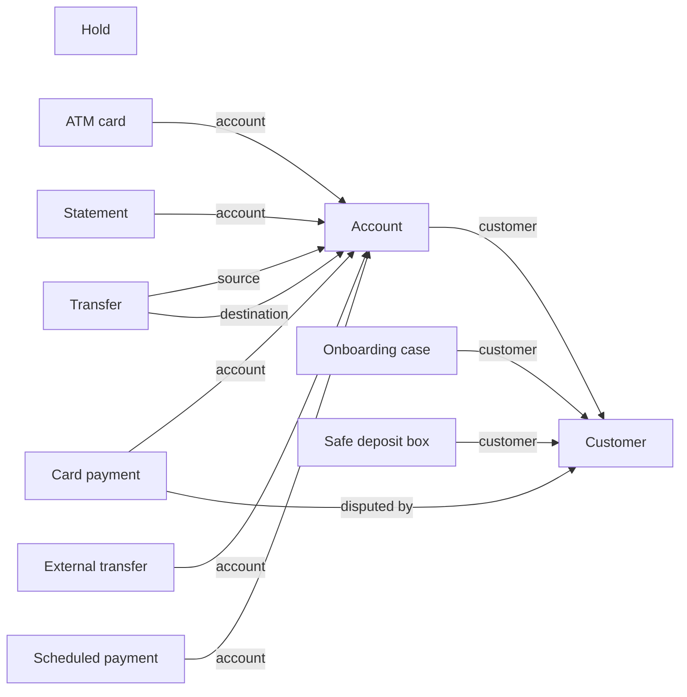

## Account

> A balance belonging to one customer, and the ledger that explains how it got there.

Starts out open. Can be open, frozen, or closed.

**How it fits**

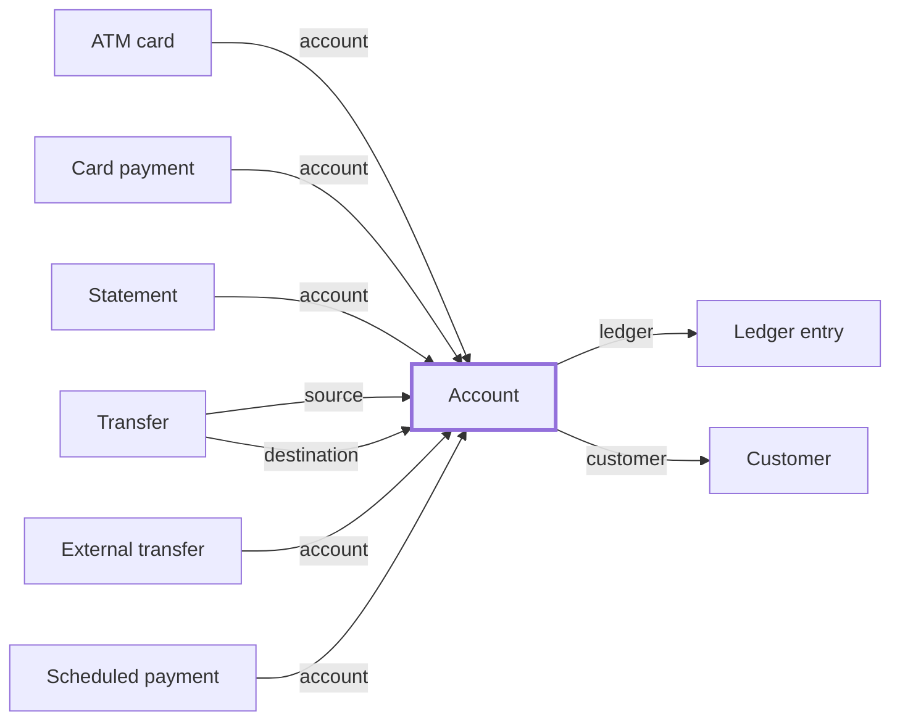

**How it moves**

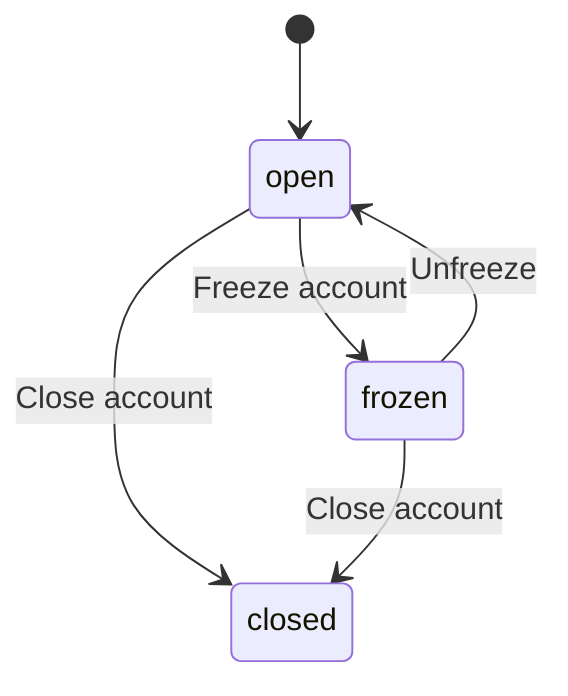

- Freezing an account moves it from open to frozen.
- Unfreezing an account moves it from frozen to open.
- Closing an account moves it from open or frozen to closed.

**Always true**

- Each account belongs to one customer.
- Each account holds its ledger, a list of ledger entries.
- The balance never goes negative.
- An account number is present.
- A daily limit is non-negative.
- A ledger sequence is positive.
- A currency is a three-letter code.
- An amount is positive.
- A movement explains itself.

### Actions

#### Accrue interest

Credit the account with interest earned. Done by the system.

Needs an amount ([Positive money](#positive-money)).

Allowed only when: the account is open; customer is active.

Raises the balance and the interest cents.

Records [Interest accrued](#interest-accrued).

#### Amend

Correct a movement posted for the wrong amount. Done by the back office.

Needs an adjustment ([Money](#money)) and a narrative ([Narrative](#narrative)).

Allowed only when: customer is active; account is open; entry is posted; an amendment leaves a non-negative amount.

Raises the amount, sets the narrative, and keeps the ledger entry posted.

Records [Ledger entry amended](#ledger-entry-amended).

#### Apply fee

Charge the account a fee. Done by the system.

Needs an amount ([Positive money](#positive-money)) and a narrative ([Narrative](#narrative)).

Allowed only when: the account is open; customer is active; the balance covers a fee.

Lowers the balance and raises the fees cents.

Records [Fee applied](#fee-applied).

#### Close account

Close an account that has been emptied. Done by the branch clerk.

Allowed only when: the account is open or frozen; customer is not closed; an account closes empty.

Moves the account from open or frozen to closed.

Records [Account closed](#account-closed).

#### Correct fee

Reverse a fee that was applied in error. Done by the back office.

Needs an amount ([Positive money](#positive-money)).

Allowed only when: the account is open; customer is active; a correction cannot exceed collected fees.

Corrects the fee applied, raises the balance, and lowers the fees cents.

Records [Fee corrected](#fee-corrected).

#### Correct interest

Reverse interest that was accrued in error. Done by the back office.

Needs an amount ([Positive money](#positive-money)).

Allowed only when: the account is open; customer is active; a correction cannot exceed accrued interest; the balance covers an interest correction.

Lowers the balance and the interest cents.

Records [Interest corrected](#interest-corrected).

#### Credit

Put money in. Done by the teller.

Needs an amount ([Positive money](#positive-money)) and a narrative ([Narrative](#narrative)).

Allowed only when: the account is open; customer is active.

Raises the balance and adds to the ledger.

Records [Account credited](#account-credited).

#### Debit

Take money out, if it is there to take. Done by the teller.

Needs an amount ([Positive money](#positive-money)) and a narrative ([Narrative](#narrative)).

Allowed only when: the account is open; customer is active; the balance covers it; the daily limit allows it.

Lowers the balance and adds to the ledger.

Afterwards, always: the balance fell by exactly the amount; a ledger entry was posted.

Records [Account debited](#account-debited).

#### Freeze account

Stop an account moving while something is investigated. Done by the compliance officer.

Allowed only when: the account is open; customer is not closed.

Moves the account from open to frozen.

Records [Account frozen](#account-frozen).

#### Open

Give a customer somewhere to keep money. Done by the branch clerk.

Needs a customer ([Customer](#customer)), a number ([Account number](#account-number)), a kind ([Account kind](#account-kind)), and a daily limit ([Daily limit](#daily-limit)).

Allowed only when: customer is active.

Sets the customer, the number, the kind, and the daily limit.

Records [Account opened](#account-opened).

#### Reverse

Undo a movement that should not have been posted. Done by the back office.

Needs a narrative ([Narrative](#narrative)).

Allowed only when: customer is active; account is open; entry is posted.

Sets the narrative and moves the ledger entry from posted to reversed.

Records [Ledger entry reversed](#ledger-entry-reversed).

#### Unfreeze

Release a cleared account. Done by the compliance officer.

Allowed only when: the account is frozen; customer is active.

Moves the account from frozen to open.

Records [Account unfrozen](#account-unfrozen).

### What it records

#### Account closed

Recorded after [Close account](#close-account). Prompts [Retire cards on account closure](#retire-cards-on-account-closure) and [Notify on closure](#notify-on-closure).

#### Account credited

Recorded after [Credit](#credit).

#### Account debited

Recorded after [Debit](#debit).

#### Account frozen

Recorded after [Freeze account](#freeze-account). Prompts [Review on freeze](#review-on-freeze).

#### Account opened

Recorded after [Open](#open).

#### Account unfrozen

Recorded after [Unfreeze](#unfreeze).

#### Fee applied

Recorded after [Apply fee](#apply-fee).

#### Fee corrected

Recorded after [Correct fee](#correct-fee).

#### Interest accrued

Recorded after [Accrue interest](#accrue-interest).

#### Interest corrected

Recorded after [Correct interest](#correct-interest).

#### Ledger entry amended

Recorded after [Amend](#amend).

#### Ledger entry reversed

Recorded after [Reverse](#reverse).

### What happens on its own

#### Notify on closure

When [Account closed](#account-closed) happens, Notifications is asked to send, in Notifications.

#### Retire cards on account closure

When [Account closed](#account-closed) happens, [ATM card](#atm-card) is asked to [Retire](#retire), once for each row of [Live for account](#live-for-account).

#### Review on freeze

When [Account frozen](#account-frozen) happens, Review is asked to open, in Compliance.

### Lists

#### At most

Accounts holding no more than a cap the caller supplies — the small-balance closure candidates.

Accounts whose balance is at most the cap you give, sorted by balance, lowest first.

#### High balance

Accounts holding at least a floor the caller supplies — the private-banking referral list.

Accounts whose balance is at least the floor you give, sorted by balance, highest first.

#### Open (the list)

Accounts that can transact today.

Accounts that are open, sorted by account number, A to Z.

#### Open for customer

One customer's own open accounts — the for_each target that freezes every one of them on suspension, not just whichever the event payload happened to carry.

Accounts whose customer is the reference you give and that are open, sorted by account number, A to Z.

#### Open for suspended customers

Open accounts whose customer has since been suspended — live money movement nobody should be approving right now.

Accounts that are open and whose customer's status is suspended, sorted by account number, A to Z.

#### Open paged

Open accounts by number, one page at a time — the account list a screen pages through.

Accounts that are open, sorted by account number, A to Z.

Shows at most 25.

#### Overdrawn

Accounts below a floor the caller supplies — the morning risk report.

Accounts whose balance is less than the floor you give, sorted by balance, lowest first.

Shows at most 100.

#### Reachable

Accounts that still exist as far as a caller is concerned — anything short of closed.

Accounts that are open or frozen, sorted by account number, A to Z.

#### Reversed

Entries that were undone — the audit trail nobody wants to need.

Ledger entries that are reversed.

#### Strictly above

Accounts holding MORE than a floor the caller supplies — the referral list without the accounts sitting exactly on the line.

Accounts whose balance is more than the floor you give, sorted by balance, highest first.

### What it is made of

#### Account kind

One of current, savings, or reserve.

#### Account number

Text that must not be blank.

Always true: an account number is present.

#### Daily limit

Made up of cents (a whole number).

Always true: a daily limit is non-negative.

#### Ledger direction

One of credit or debit.

#### Ledger entry

One movement across the account, in the order it was posted.

Starts out posted. Can be posted or reversed.

#### Ledger sequence

A whole number.

Always true: a ledger sequence is positive.

#### Money

Made up of cents (a whole number) and currency (text).

Always true: a currency is a three-letter code.

#### Narrative

Made up of text (text, must not be blank).

Always true: a movement explains itself.

#### Positive money

Made up of cents (a whole number) and currency (text).

Always true: an amount is positive; a currency is a three-letter code.

## ATM card

> A card issued against an account, and the cash taken with it.

Starts out issued. Can be issued, active, or retired.

**How it fits**

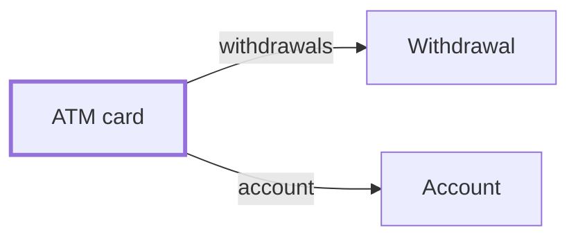

**How it moves**

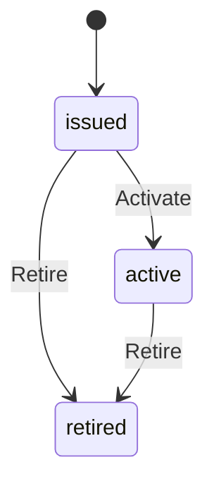

- Activating an ATM card moves it from issued to active.
- Retiring an ATM card moves it from issued or active to retired.

**Always true**

- Each ATM card belongs to one account.
- Each ATM card holds a list of withdrawals.
- A card serial is present.
- A daily fee is non-negative.
- A withdrawal sequence is positive.
- A withdrawal amount is positive.
- A withdrawal explains itself.

### Actions

#### Activate

Start using a card. Done by the customer.

Allowed only when: the ATM card is issued; customer is active.

Moves the ATM card from issued to active.

Records [ATM card activated](#atm-card-activated).

#### Dispute

Challenge a withdrawal that was not mine. Done by the customer.

Needs a narrative ([Narrative](#narrative-1)).

Allowed only when: the withdrawal is taken; customer is active; account is open; card is not retired.

Sets the narrative and moves the withdrawal from taken to disputed.

Records [Withdrawal disputed](#withdrawal-disputed).

#### Issue

Put a card in a customer's hand. Done by the branch clerk.

Needs an account ([Account](#account)), a serial ([Card serial](#card-serial)), and a daily fee ([Daily fee](#daily-fee)).

Allowed only when: customer is active; account is open.

Sets the account, the serial, and the daily fee.

Records [ATM card issued](#atm-card-issued).

#### Rename

Name a card so it is recognisable. Done by the customer.

Needs a nickname ([Card nickname](#card-nickname)).

Allowed only when: the ATM card is issued or active; customer is active.

Sets the nickname.

Records [ATM card renamed](#atm-card-renamed).

#### Retire

Take a card out of service. Done by the back office.

Allowed only when: the ATM card is issued or active; customer is active.

Moves the ATM card from issued or active to retired.

Records [ATM card retired](#atm-card-retired).

#### Withdraw

Take cash out at a machine. Done by the customer.

Needs a cents ([Withdrawal amount](#withdrawal-amount)) and a narrative ([Narrative](#narrative-1)).

Allowed only when: the ATM card is active; customer is active; account is open.

Adds to the withdrawals.

Records [Cash withdrawn](#cash-withdrawn).

### What it records

#### ATM card activated

Recorded after [Activate](#activate).

#### ATM card issued

Recorded after [Issue](#issue).

#### ATM card renamed

Recorded after [Rename](#rename).

#### ATM card retired

Recorded after [Retire](#retire).

#### Cash withdrawn

Recorded after [Withdraw](#withdraw).

#### Withdrawal disputed

Recorded after [Dispute](#dispute).

### Lists

#### Active

Live cards in nickname order, unnamed ones last — real nicknames sort among themselves first.

ATM cards that are active, sorted by card nickname, A to Z, with ATM cards that have no card nickname last.

#### By fee

Live cards by what they cost to hold, cheapest first — a fee is a Float, so the order is numeric and not alphabetical.

ATM cards that are active, sorted by daily fee, lowest first.

Shows at most 3.

#### Live for account

One account's cards that can still be used — the ones its closure retires.

ATM cards whose account is the number you give and that are issued or active, sorted by card serial, A to Z.

#### Recent

The first two withdrawals still standing, whatever else was taken.

Withdrawals that are taken.

Shows at most 2.

### What it is made of

#### Card nickname

Text.

#### Card serial

Text that must not be blank.

Always true: a card serial is present.

#### Daily fee

Made up of amount (a number).

Always true: a daily fee is non-negative.

#### Narrative

Made up of text (text, must not be blank).

Always true: a withdrawal explains itself.

#### Withdrawal

One handful of cash, in the order it was taken.

Starts out taken. Can be taken or disputed.

#### Withdrawal amount

Made up of cents (a whole number).

Always true: a withdrawal amount is positive.

#### Withdrawal sequence

A whole number.

Always true: a withdrawal sequence is positive.

## Card payment

> A card authorisation that either settles, is voided before settlement, or becomes a post-settlement dispute.

Starts out authorized. Can be authorized, captured, voided, refunded, reversed, disputed, or charged back.

**How it fits**

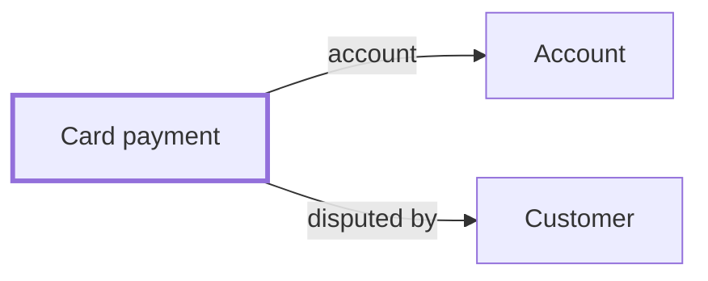

**How it moves**

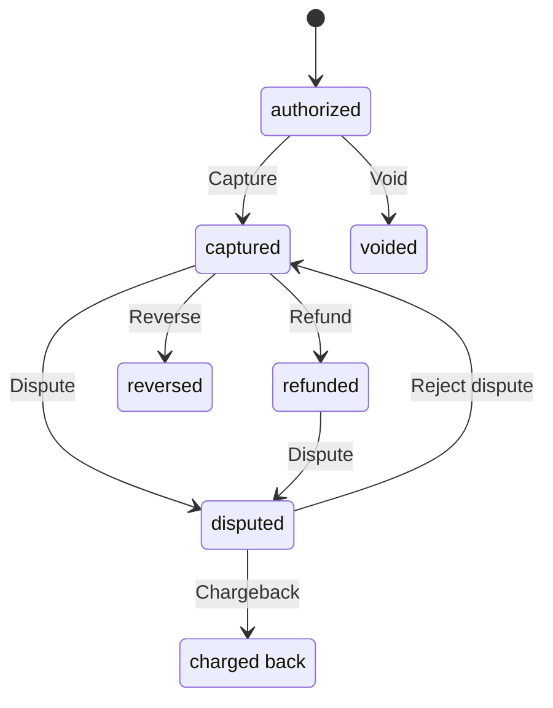

- Capturing a card payment moves it from authorized to captured.
- Voiding a card payment moves it from authorized to voided.
- Refunding a card payment moves it from captured to refunded.
- Reversing a card payment moves it from captured to reversed.
- Disputing a card payment moves it from captured or refunded to disputed.
- Charging back a card payment moves it from disputed to charged back.
- Rejecting a dispute moves the card payment from disputed to captured.

**Always true**

- Each card payment belongs to one account.
- Each card payment can be disputed by one customer.
- Each card payment holds a list of tags.
- A payment amount is positive.
- A merchant name is present.
- A tag is not the empty string.

### Actions

#### Authorize

Put a hold on funds for a purchase.

Needs an authorisation ([Authorisation code](#authorisation-code)), tags (a list of [Tag](#tag), optional), an account ([Account](#account)), an amount ([Payment amount](#payment-amount)), and a merchant ([Merchant name](#merchant-name)).

Allowed only when: customer is active; account is open.

Sets the account, the amount, the merchant, the tags, and the authorisation.

Records [Card authorized](#card-authorized).

#### Capture

Turn an authorization into an actual charge. Done by the system.

Allowed only when: the card payment is authorized; customer is active; account is open.

Moves the card payment from authorized to captured.

Records [Card captured](#card-captured).

#### Chargeback

Uphold a customer's dispute and claw the charge back. Done by the compliance officer.

Allowed only when: the card payment is disputed; customer is active; account is open.

Moves the card payment from disputed to charged back.

Records [Card charged back](#card-charged-back).

#### Dispute

Challenge a payment that already settled. Done by the customer.

Needs a disputed by ([Customer](#customer)).

Allowed only when: the card payment is captured or refunded; account is open; customer is active.

Sets the disputed by and moves the card payment from captured or refunded to disputed.

Records [Card disputed](#card-disputed).

#### Refund

Give the money back after a charge settled. Done by the system.

Allowed only when: the card payment is captured; customer is active; account is open.

Moves the card payment from captured to refunded.

Records [Card refunded](#card-refunded).

#### Reject dispute

Uphold the charge and close a customer's dispute. Done by the compliance officer.

Allowed only when: the card payment is disputed; customer is active; account is open.

Moves the card payment from disputed to captured.

Records [Card dispute rejected](#card-dispute-rejected).

#### Reverse

Undo a captured charge with no customer dispute involved. Done by the system.

Allowed only when: the card payment is captured; customer is active; account is open.

Moves the card payment from captured to reversed.

Records [Card reversed](#card-reversed).

#### Void

Cancel an authorization before it settles. Done by the system.

Allowed only when: the card payment is authorized; customer is active; account is open.

Moves the card payment from authorized to voided.

Records [Card voided](#card-voided).

### What it records

#### Card authorized

Recorded after [Authorize](#authorize).

#### Card captured

Recorded after [Capture](#capture).

#### Card charged back

Recorded after [Chargeback](#chargeback).

#### Card dispute rejected

Recorded after [Reject dispute](#reject-dispute).

#### Card disputed

Recorded after [Dispute](#dispute-1).

#### Card refunded

Recorded after [Refund](#refund).

#### Card reversed

Recorded after [Reverse](#reverse-1).

#### Card voided

Recorded after [Void](#void).

### Lists

#### Disputed

Charges currently under a customer's dispute, awaiting a compliance decision.

Card payments that are disputed.

#### Flagged

Charges carrying a risk tag, for the fraud queue.

Card payments whose tag includes high risk.

#### Pending

Authorized charges not yet captured, voided, or otherwise resolved.

Card payments that are authorized.

### What it is made of

#### Authorisation code

Text that must not be blank.

#### Merchant name

Text that must not be blank.

Always true: a merchant name is present.

#### Payment amount

Made up of cents (a whole number).

Always true: a payment amount is positive.

#### Tag

Text that must not be blank.

Always true: a tag is not the empty string.

## Customer

> A person the bank holds a relationship with. Suspended rather than deleted — a bank forgets nothing.

Starts out active. Can be active, suspended, or closed.

**How it fits**

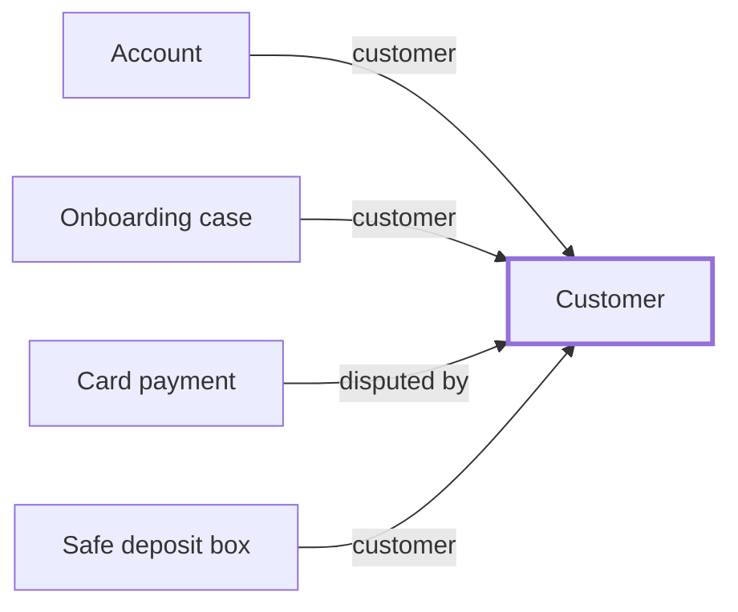

**How it moves**

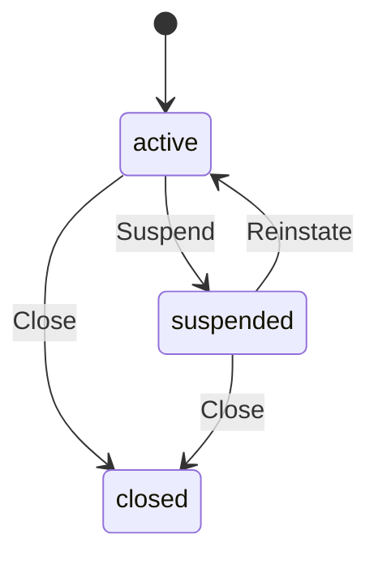

- Suspending a customer moves it from active to suspended.
- Reinstating a customer moves it from suspended to active.
- Closing a customer moves it from active or suspended to closed.

**Always true**

- A customer number is never empty.
- A standing is named.
- A given name is present.
- A family name is present.

### Actions

#### Close

End the relationship. Done by the branch clerk.

Allowed only when: the customer is active or suspended.

Moves the customer from active or suspended to closed.

Records [Customer closed](#customer-closed).

#### Register

Take on a new customer. Done by the branch clerk.

Needs a reference ([Customer number](#customer-number)), a name ([Person name](#person-name)), and an email ([Email address](#email-address)).

Sets the reference, the name, and the email.

Records [Customer registered](#customer-registered).

#### Reinstate

Let a cleared customer transact again. Done by the compliance officer.

Allowed only when: the customer is suspended.

Sets the standing and moves the customer from suspended to active.

Records [Customer reinstated](#customer-reinstated).

#### Suspend

Stop a customer transacting while something is investigated. Done by the compliance officer.

Needs a standing ([Customer standing](#customer-standing)).

Allowed only when: the customer is active.

Sets the standing and moves the customer from active to suspended.

Records [Customer suspended](#customer-suspended).

### What it records

#### Customer closed

Recorded after [Close](#close).

#### Customer registered

Recorded after [Register](#register).

#### Customer reinstated

Recorded after [Reinstate](#reinstate).

#### Customer suspended

Recorded after [Suspend](#suspend). Prompts [Freeze accounts on suspension](#freeze-accounts-on-suspension).

### What happens on its own

#### Freeze accounts on suspension

When [Customer suspended](#customer-suspended) happens, [Account](#account) is asked to [Freeze account](#freeze-account), once for each row of [Open for customer](#open-for-customer).

### Lists

#### In good standing

The everyday customer roll — active, and nothing outstanding against them.

Customers that are active and whose customer standing is good, sorted by customer number, A to Z.

#### Not good standing

Everyone who is not in the everyday roll — suspended, under review, or anything else that is not simply "good".

Customers whose customer standing is not good, sorted by customer number, A to Z.

#### Suspended

The compliance queue, newest concern first.

Customers that are suspended, sorted by customer number, Z to A.

Shows at most 50.

### What it is made of

#### Customer number

Text that must not be blank.

Always true: a customer number is never empty.

#### Customer standing

Text that must not be blank.

Always true: a standing is named.

#### Email address

Made up of address (text, must follow a set format).

#### Person name

Made up of given (text, must not be blank) and family (text, must not be blank).

Always true: a given name is present; a family name is present.

## External transfer

> A transfer sent beyond the bank, where a recall is an instruction and a return is the external network's outcome.

Starts out requested. Can be requested, sent, recalled, or returned.

**How it fits**

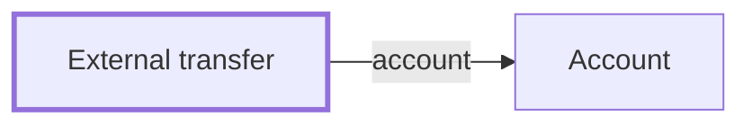

**How it moves**

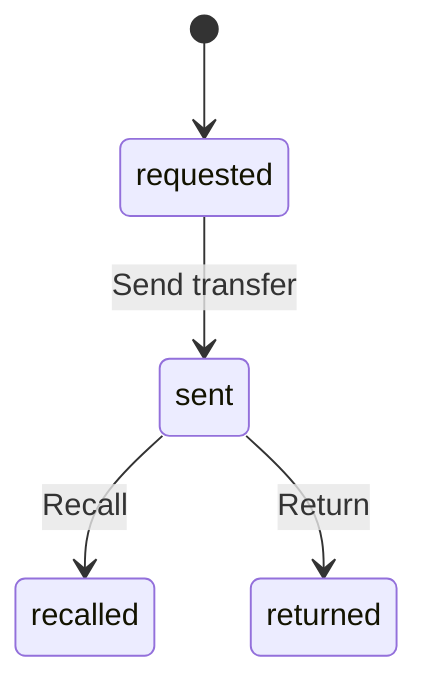

- Sending a transfer moves the external transfer from requested to sent.
- Recalling an external transfer moves it from sent to recalled.
- Returning an external transfer moves it from sent to returned.

**Always true**

- Each external transfer belongs to one account.
- An external transfer amount is positive.
- A beneficiary name is present.

### Actions

#### Recall

Ask the external network to stop a transfer already sent. Done by the customer.

Allowed only when: the external transfer is sent; customer is active; account is open.

Moves the external transfer from sent to recalled.

Records [External transfer recalled](#external-transfer-recalled).

#### Request

Send money to an account outside the bank. Done by the customer.

Needs an end to end ([End to end reference](#end-to-end-reference)), an account ([Account](#account)), an amount ([External amount](#external-amount)), a beneficiary ([Beneficiary name](#beneficiary-name)), and a direction ([Movement direction](#movement-direction)).

Allowed only when: customer is active; account is open.

Sets the account, the amount, the beneficiary, the direction, and the end to end.

Records [External transfer requested](#external-transfer-requested).

#### Return

Record that the external network sent the money back. Done by the system.

Allowed only when: the external transfer is sent; customer is active; account is open.

Moves the external transfer from sent to returned.

Records [External transfer returned](#external-transfer-returned).

#### Send transfer

Release the transfer to the external network. Done by the system.

Allowed only when: the external transfer is requested; customer is active; account is open.

Moves the external transfer from requested to sent.

Records [External transfer sent](#external-transfer-sent).

### What it records

#### External transfer recalled

Recorded after [Recall](#recall).

#### External transfer requested

Recorded after [Request](#request).

#### External transfer returned

Recorded after [Return](#return).

#### External transfer sent

Recorded after [Send transfer](#send-transfer).

### What happens on its own

#### External settlement

Begins when [External transfer requested](#external-transfer-requested) happens and ends when [External transfer sent](#external-transfer-sent) happens. Along the way it can be requested or returned.

### Lists

#### Sent

Transfers already released to the external network, awaiting its outcome.

External transfers that are sent.

### What it is made of

#### Beneficiary name

Text that must not be blank.

Always true: a beneficiary name is present.

#### End to end reference

Text that must not be blank.

#### External amount

Made up of cents (a whole number).

Always true: an external transfer amount is positive.

#### Movement direction

Text.

## Hold

> A stop the bank puts on an account or on a card while something is looked into.

Starts out placed. Can be placed, lifted, or escalated.

**How it moves**

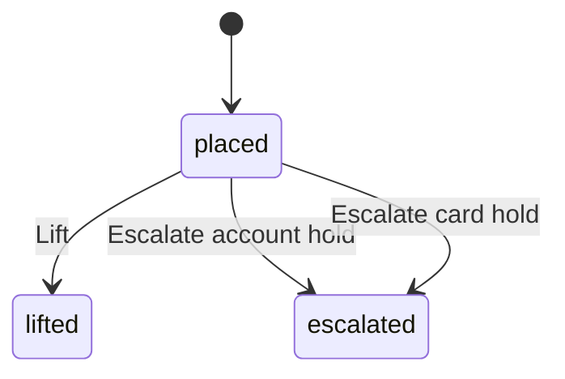

- Lifting a hold moves it from placed to lifted.
- Escalating an account hold moves it from placed to escalated.
- Escalating a card hold moves it from placed to escalated.

**Always true**

- Each hold points at its subject: one account or ATM card.
- A hold reference is present.
- A hold reason is present.

### Actions

#### Escalate account hold

Send a hold on an account to the account review desk. Done by the system.

Allowed only when: the hold is placed; the hold is on an account.

Moves the hold from placed to escalated.

Records [Account hold escalated](#account-hold-escalated).

#### Escalate card hold

Send a hold on a card to the card review desk. Done by the system.

Allowed only when: the hold is placed; the hold is on a card.

Moves the hold from placed to escalated.

Records [Card hold escalated](#card-hold-escalated).

#### Lift

Take a hold off once the matter is settled. Done by the teller.

Allowed only when: the hold is placed.

Moves the hold from placed to lifted.

Records [Hold lifted](#hold-lifted).

#### Place

Stop an account or a card while something is looked into. Done by the teller.

Needs a reference ([Hold reference](#hold-reference)), a subject ([Subject](#subject)), and a reason ([Hold reason](#hold-reason)).

Sets the reference, the subject, and the reason.

Records [Hold placed](#hold-placed).

### What it records

#### Account hold escalated

Recorded after [Escalate account hold](#escalate-account-hold).

#### Card hold escalated

Recorded after [Escalate card hold](#escalate-card-hold).

#### Hold lifted

Recorded after [Lift](#lift).

#### Hold placed

Recorded after [Place](#place).

### What it is made of

#### Hold reason

Text that must not be blank.

Always true: a hold reason is present.

#### Hold reference

Text that must not be blank.

Always true: a hold reference is present.

#### Subject

Made up of type (text) and id (text).

#### Subject type

One of [Account](#account) or [ATM card](#atm-card).

## Onboarding case

> The KYC check a newly registered customer clears before an account exists for them — screened once, and if it does not clear there is nothing to undo, because nothing was ever opened.

Starts out screening. Can be screening, cleared, or declined.

**How it fits**

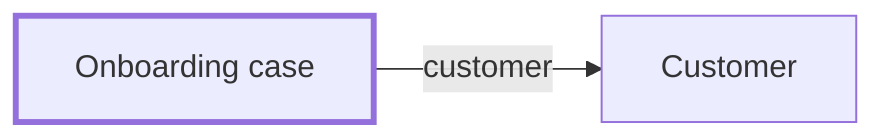

**How it moves**

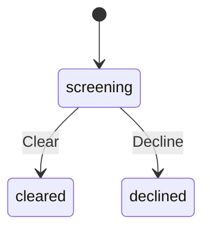

- Clearing an onboarding case moves it from screening to cleared.
- Declining an onboarding case moves it from screening to declined.

**Always true**

- Each onboarding case belongs to one customer.
- An onboarding reference is never empty.
- An account number is present.

### Actions

#### Clear

Pass a customer's identity and screening checks. Done by the compliance officer.

Allowed only when: the onboarding case is screening; customer is active.

Moves the onboarding case from screening to cleared.

Records [Onboarding cleared](#onboarding-cleared).

#### Decline

Refuse a customer who does not clear screening — no account was ever opened, so nothing is undone. Done by the compliance officer.

Allowed only when: the onboarding case is screening; customer is active.

Moves the onboarding case from screening to declined.

Records [Onboarding declined](#onboarding-declined).

#### Open

Open a KYC case for a newly registered customer, naming the account it will become. Done by the branch clerk.

Needs a customer ([Customer](#customer)), a reference ([Onboarding reference](#onboarding-reference)), and an account number ([Account number](#account-number-1)).

Allowed only when: customer is active.

Sets the customer, the reference, and the account number.

Records [Onboarding opened](#onboarding-opened).

### What it records

#### Onboarding cleared

Recorded after [Clear](#clear).

#### Onboarding declined

Recorded after [Decline](#decline).

#### Onboarding opened

Recorded after [Open](#open-1).

### What happens on its own

#### Onboarding

Begins when [Onboarding opened](#onboarding-opened) happens and ends when [Account opened](#account-opened) happens. Along the way it can be screening, cleared, or declined.

### Lists

#### Screening

Cases still waiting on a compliance decision.

Onboarding cases that are screening, sorted by onboarding reference, A to Z.

### What it is made of

#### Account number

Text that must not be blank.

Always true: an account number is present.

#### Onboarding reference

Text that must not be blank.

Always true: an onboarding reference is never empty.

## Safe deposit box

> A steel box in the vault, held under one customer's name and opened only against the branch and number stamped on its face.

Starts out vacant. Can be vacant or rented.

**How it fits**

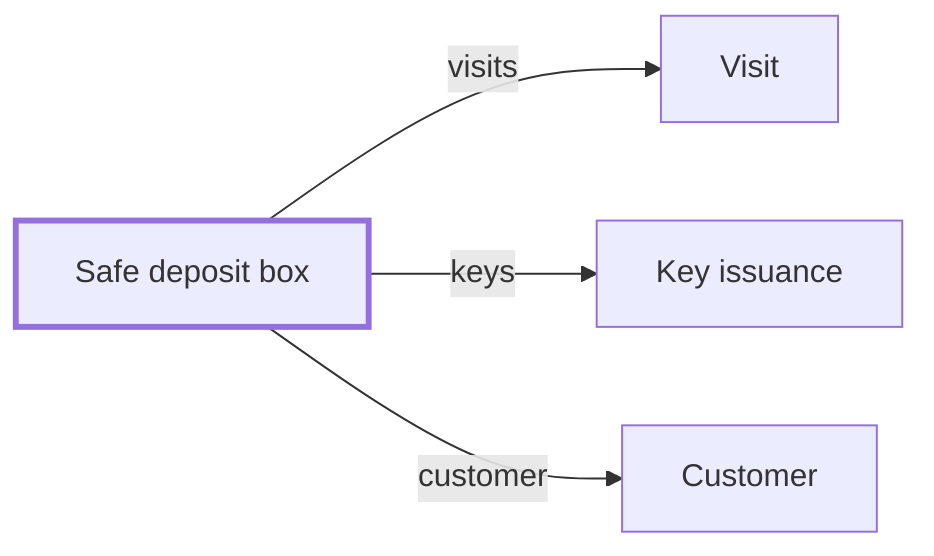

**How it moves**

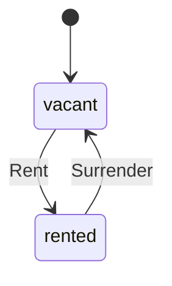

- Renting a safe deposit box moves it from vacant to rented.
- Surrendering a safe deposit box moves it from rented to vacant.

**Always true**

- Each safe deposit box belongs to one customer.
- Each safe deposit box holds a list of visits.
- Each safe deposit box holds its keys, a list of key issuances.
- A branch is coded.
- A box is numbered from one.
- A visit sequence is positive.
- A visit names its date.
- A key is serialed.
- A written note is not blank.

### Actions

#### Annotate

Note something unusual about a visit after the fact. Done by the vault officer.

Needs a note ([Visit note](#visit-note)).

Allowed only when: the visit is logged; customer is active; box is rented.

Sets the note and keeps the visit logged.

Records [Visit annotated](#visit-annotated).

#### Issue key

Cut a key for the box. Done by the vault officer.

Needs a serial ([Key serial](#key-serial)).

Allowed only when: the safe deposit box is rented; customer is active.

Adds to the keys.

Records [Key issued](#key-issued).

#### Log visit

Record that the box was opened. Done by the vault officer.

Needs a date ([Visit date](#visit-date)), a sequence ([Visit sequence](#visit-sequence)), and a note ([Visit note](#visit-note), optional).

Allowed only when: the safe deposit box is rented; customer is active.

Adds to the visits.

Records [Box opened](#box-opened).

#### Rent

Assign the box to a customer. Done by the branch clerk.

Needs a branch code ([Branch code](#branch-code)), a box number ([Box number](#box-number)), a size ([Size](#size)), and a customer ([Customer](#customer)).

Allowed only when: the safe deposit box is vacant; customer is active.

Sets the customer, the branch code, the box number, and the size and moves the safe deposit box from vacant to rented.

Records [Box rented](#box-rented).

#### Return

Take a key back when a holder is done with it. Done by the vault officer.

Needs a serial ([Key serial](#key-serial)).

Allowed only when: customer is active; box is rented.

Moves the key issuance from issued to returned.

Records [Key returned](#key-returned).

#### Surrender

Give the box back and take the keys off the account. Done by the customer.

Allowed only when: the safe deposit box is rented; customer is active.

Moves the safe deposit box from rented to vacant.

Records [Box surrendered](#box-surrendered) and [Key return due](#key-return-due).

### What it records

#### Box opened

Recorded after [Log visit](#log-visit).

#### Box rented

Recorded after [Rent](#rent).

#### Box surrendered

Recorded after [Surrender](#surrender). Prompts [Review on box surrender](#review-on-box-surrender).

#### Key issued

Recorded after [Issue key](#issue-key).

#### Key return due

Recorded after [Surrender](#surrender). Prompts [Flag key return](#flag-key-return).

#### Key returned

Recorded after [Return](#return-1).

#### Visit annotated

Recorded after [Annotate](#annotate).

### What happens on its own

#### Flag key return

When [Key return due](#key-return-due) happens, Notifications is asked to send, in Notifications.

#### Review on box surrender

When [Box surrendered](#box-surrendered) happens, Review is asked to open, in Compliance.

### Lists

#### Recent

The last few visits, whatever the box has seen.

Visits that are logged.

Shows at most 5.

#### Rented

Boxes currently assigned to a customer, for the annual access audit.

Safe deposit boxes that are rented, sorted by branch code, A to Z.

### What it is made of

#### Box number

A whole number.

Always true: a box is numbered from one.

#### Branch code

Text that must not be blank.

Always true: a branch is coded.

#### Key issuance

One key cut for the box, held by whoever last signed for it.

Starts out issued. Can be issued or returned.

#### Key serial

Text that must not be blank.

Always true: a key is serialed.

#### Size

One of small, medium, or large.

#### Visit

One opening of the box, in the order it happened that day.

Starts out logged. Can be logged.

#### Visit date

Text that must not be blank.

Always true: a visit names its date.

#### Visit note

Made up of text (text).

#### Visit sequence

A whole number.

Always true: a visit sequence is positive.

## Scheduled payment

> An instruction held for a future date, which may execute once or be cancelled before it does.

Starts out scheduled. Can be scheduled, executed, cancelled, failed, or abandoned.

**How it fits**

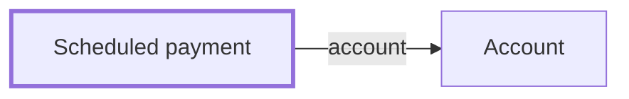

**How it moves**

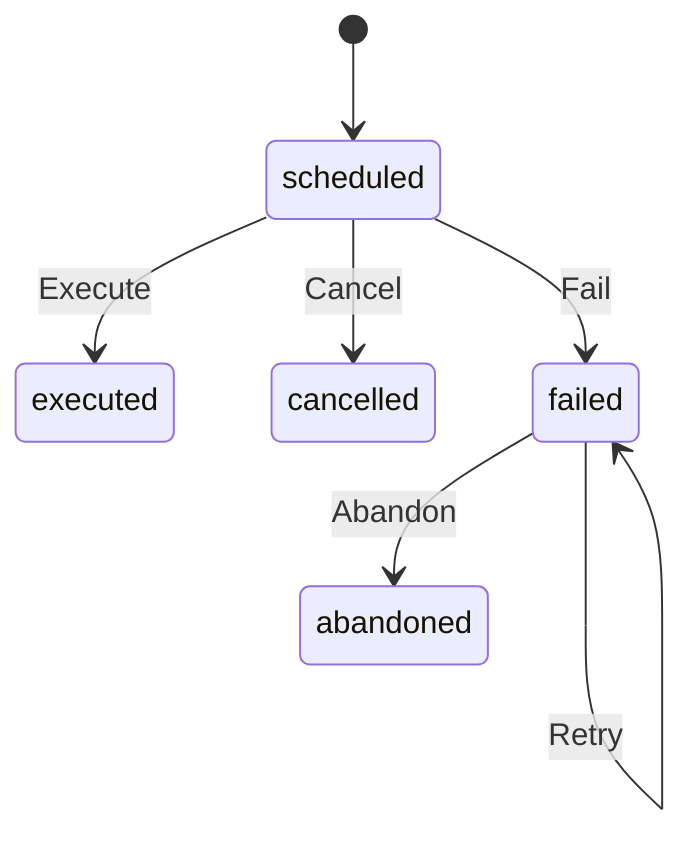

- Executing a scheduled payment moves it from scheduled to executed.
- Cancelling a scheduled payment moves it from scheduled to cancelled.
- Failing a scheduled payment moves it from scheduled to failed.
- Retrying a scheduled payment keeps it failed.
- Abandoning a scheduled payment moves it from failed to abandoned.

**Always true**

- Each scheduled payment belongs to one account.
- A scheduled payment amount is positive.
- A payment recipient is present.
- A payment due date is present.
- A retry count is non-negative.
- A retry limit is positive.

### Actions

#### Abandon

Give up on a payment that could not be collected after every retry. Done by the back office.

Allowed only when: the scheduled payment is failed; customer is active; account is open; every retry is exhausted.

Moves the scheduled payment from failed to abandoned.

Records [Scheduled payment abandoned](#scheduled-payment-abandoned).

#### Cancel

Call off a payment before its due date. Done by the customer.

Allowed only when: the scheduled payment is scheduled; customer is active; account is open.

Moves the scheduled payment from scheduled to cancelled.

Records [Scheduled payment cancelled](#scheduled-payment-cancelled).

#### Execute

Collect a payment on its due date. Done by the system.

Allowed only when: the scheduled payment is scheduled; customer is active; account is open.

Moves the scheduled payment from scheduled to executed.

Records [Scheduled payment executed](#scheduled-payment-executed).

#### Fail

Record that today's presentment could not be collected. Done by the system.

Allowed only when: the scheduled payment is scheduled; customer is active; account is open.

Moves the scheduled payment from scheduled to failed.

Records [Scheduled payment failed](#scheduled-payment-failed).

#### Retry

Re-present a failed payment, up to the limit the schedule names. Done by the system.

Allowed only when: the scheduled payment is failed; customer is active; account is open; a retry is still allowed.

Raises the attempts and keeps the scheduled payment failed.

Afterwards, always: a retry never lowers the attempt count.

Records [Scheduled payment failed](#scheduled-payment-failed).

#### Schedule

Set up a payment to collect on a future date. Done by the customer.

Needs an instruction ([Instruction reference](#instruction-reference)), an account ([Account](#account)), an amount ([Scheduled amount](#scheduled-amount)), a recipient ([Payment recipient](#payment-recipient)), and a due on ([Payment due date](#payment-due-date)).

Allowed only when: customer is active; account is open.

Sets the account, the amount, the recipient, the due on, and the instruction.

Records [Payment scheduled](#payment-scheduled).

### What it records

#### Payment scheduled

Recorded after [Schedule](#schedule).

#### Scheduled payment abandoned

Recorded after [Abandon](#abandon).

#### Scheduled payment cancelled

Recorded after [Cancel](#cancel).

#### Scheduled payment executed

Recorded after [Execute](#execute).

#### Scheduled payment failed

Recorded after [Fail](#fail) or [Retry](#retry). Prompts [Retry on payment failure](#retry-on-payment-failure).

### What happens on its own

#### Retry on payment failure

When [Scheduled payment failed](#scheduled-payment-failed) happens, [Scheduled payment](#scheduled-payment) is asked to [Retry](#retry).

### Lists

#### Due

Payments still scheduled, ordered by when they're due.

Scheduled payments that are scheduled, sorted by payment due date, A to Z.

### What it is made of

#### Instruction reference

Text that must not be blank.

#### Payment due date

Text that must not be blank.

Always true: a payment due date is present.

#### Payment recipient

Text that must not be blank.

Always true: a payment recipient is present.

#### Retry count

A whole number.

Always true: a retry count is non-negative.

#### Retry limit

A whole number.

Always true: a retry limit is positive.

#### Scheduled amount

Made up of cents (a whole number).

Always true: a scheduled payment amount is positive.

## Statement

> A snapshot of one account's activity over one period, generated once and never revised.

**How it fits**

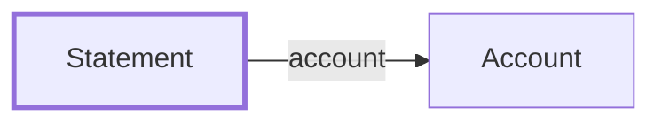

**Always true**

- Each statement belongs to one account.
- A statement names its period.
- A statement is dated.

### Actions

#### Generate

Close out one period's activity into a permanent record. Done by the system.

Needs a period ([Statement period](#statement-period)), an opening balance ([Statement amount](#statement-amount)), a closing balance ([Statement amount](#statement-amount)), a generated on ([Statement date](#statement-date)), a frequency ([Statement frequency](#statement-frequency)), and an account ([Account](#account)).

Allowed only when: customer is active; account is open.

Sets the account, the period, the opening balance, the closing balance, the generated on, and the frequency.

Records [Statement generated](#statement-generated).

### What it records

#### Statement generated

Recorded after [Generate](#generate).

### What it is made of

#### Statement amount

Made up of cents (a whole number).

#### Statement date

Text that must not be blank.

Always true: a statement is dated.

#### Statement frequency

One of: monthly (retention months 84, paper fee cents 0); quarterly (retention months 120, paper fee cents 0); annual (retention months 240, paper fee cents 500).

#### Statement period

Text that must not be blank.

Always true: a statement names its period.

## Transfer

> Money leaving one account for another. Two movements that must both happen, or neither.

Starts out requested. Can be requested, debited, credited, settled, reversed, or rejected.

**How it fits**

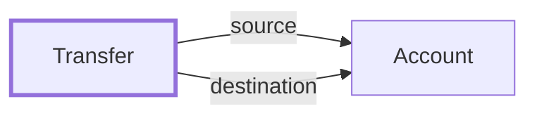

**How it moves**

```mermaid
stateDiagram-v2
    [*] --> requested
    requested --> debited: Debited
    debited --> credited: Credited
    credited --> settled: Settle
    debited --> reversed: Reverse
    requested --> rejected: Reject
```

- Marking a transfer debited moves it from requested to debited.
- Marking a transfer credited moves it from debited to credited.
- Settling a transfer moves it from credited to settled.
- Reversing a transfer moves it from debited to reversed.
- Rejecting a transfer moves it from requested to rejected.

**Always true**

- Each transfer has one source account.
- Each transfer has one destination account.
- A transfer reference is never empty.
- A transfer amount is positive.
- A transfer explains itself.

### Actions

#### Credited

Record that the destination credit committed. Done by the system.

Allowed only when: the transfer is debited; destination customer is active; destination account is open.

Moves the transfer from debited to credited.

Records [Transfer credited](#transfer-credited).

#### Debited

Record that the source account has given up the money. Done by the system.

Allowed only when: the transfer is requested; source customer is active; source account is open.

Moves the transfer from requested to debited.

Records [Transfer debited](#transfer-debited).

#### Reject

Refuse a transfer before any money moved. Done by the system.

Allowed only when: the transfer is requested; source customer is active; source account is open.

Moves the transfer from requested to rejected.

Records [Transfer rejected](#transfer-rejected).

#### Request

Send money to another account. Done by the customer.

Needs a reference ([Transfer reference](#transfer-reference)), an amount ([Transfer money](#transfer-money)), a narrative ([Narrative](#narrative-2)), a source ([Account](#account)), and a destination ([Account](#account)).

Allowed only when: source customer is active; source account is open; a transfer names its source; a transfer goes somewhere; a transfer moves BETWEEN accounts.

Sets the amount, the narrative, the source, the destination, and the reference.

Records [Transfer requested](#transfer-requested).

#### Reverse

Put the money back when the credit could not be made. Done by the system.

Allowed only when: the transfer is debited; source customer is active; source account is open.

Moves the transfer from debited to reversed.

Records [Transfer reversed](#transfer-reversed).

#### Settle

Record that the destination has received it. Done by the system.

Allowed only when: the transfer is credited; destination customer is active; destination account is open.

Moves the transfer from credited to settled.

Records [Transfer settled](#transfer-settled).

### What it records

#### Transfer credited

Recorded after [Credited](#credited).

#### Transfer debited

Recorded after [Debited](#debited).

#### Transfer rejected

Recorded after [Reject](#reject).

#### Transfer requested

Recorded after [Request](#request-1).

#### Transfer reversed

Recorded after [Reverse](#reverse-2).

#### Transfer settled

Recorded after [Settle](#settle).

### What happens on its own

#### Settlement

Begins when [Transfer requested](#transfer-requested) happens and ends when [Transfer settled](#transfer-settled) happens. Along the way it can be requested, awaiting credit, settled, or reversed.

### Lists

#### In flight

Transfers that have left one account and not arrived at the other. The list that must always empty.

Transfers that are debited, sorted by status.

### What it is made of

#### Narrative

Made up of text (text, must not be blank).

Always true: a transfer explains itself.

#### Transfer money

Made up of cents (a whole number).

Always true: a transfer amount is positive.

#### Transfer reference

Text that must not be blank.

Always true: a transfer reference is never empty.

## Roles

> Who does what. Each role is listed once, with the actions it is responsible for.

#### Back office

Responsible for [Correct fee](#correct-fee), [Correct interest](#correct-interest), [Amend](#amend), [Reverse](#reverse), [Retire](#retire), and [Abandon](#abandon).

#### Branch clerk

Responsible for [Register](#register), [Close](#close), [Open (account)](#open), [Close account](#close-account), [Open (onboarding case)](#open-1), [Issue](#issue), and [Rent](#rent).

#### Compliance officer

Responsible for [Suspend](#suspend), [Reinstate](#reinstate), [Freeze account](#freeze-account), [Unfreeze](#unfreeze), [Clear](#clear), [Decline](#decline), [Chargeback](#chargeback), and [Reject dispute](#reject-dispute).

#### Customer

Responsible for [Rename](#rename), [Withdraw](#withdraw), [Activate](#activate), [Dispute (withdrawal)](#dispute), [Dispute (card payment)](#dispute-1), [Surrender](#surrender), [Request (transfer)](#request-1), [Request (external transfer)](#request), [Recall](#recall), [Schedule](#schedule), and [Cancel](#cancel).

#### System

Responsible for [Apply fee](#apply-fee), [Accrue interest](#accrue-interest), [Escalate account hold](#escalate-account-hold), [Escalate card hold](#escalate-card-hold), [Capture](#capture), [Void](#void), [Refund](#refund), [Reverse (card payment)](#reverse-1), [Generate](#generate), [Debited](#debited), [Settle](#settle), [Credited](#credited), [Reverse (transfer)](#reverse-2), [Reject](#reject), [Send transfer](#send-transfer), [Return](#return), [Execute](#execute), [Fail](#fail), and [Retry](#retry).

#### Teller

Responsible for [Credit](#credit), [Debit](#debit), [Place](#place), and [Lift](#lift).

#### Vault officer

Responsible for [Log visit](#log-visit), [Issue key](#issue-key), [Annotate](#annotate), and [Return](#return-1).

## Read models

> Questions answered by reading more than one of the things above.

#### Accounts by kind

Every account the bank holds, sorted into what kind it is, then by its own number.

#### Card payment counts by status

How many card charges stand in each status.

#### Card payment totals by status

The total amount of every card charge, added up for each status a charge can be in.

#### Compliance dashboard

One account, its own status, and any card charges disputed against it — the working set for a compliance review.

#### Customer portfolio

A customer's cross-account position, rebuilt from aggregate heads.

#### Disputed payment average

The mean amount of an account's own disputed card charges — whether the total is one outlier or many similar ones.

#### Disputed payment count

How many of an account's own card charges are under dispute — a single number, not the rows themselves.

#### Disputed payment largest

The largest amount among an account's own disputed card charges.

#### Disputed payment median

The median amount of an account's own disputed card charges.

#### Disputed payment p95

The 95th percentile amount of an account's own disputed card charges — the tail risk a median alone hides.

#### Disputed payment smallest

The smallest amount among an account's own disputed card charges.

#### Disputed payment total

The total amount of an account's own disputed card charges — the exposure a risk manager wants first.

#### Holds on cards

Every hold the bank has put on a card, rather than on an account.
