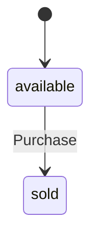

# Pizzas glossary

> Put toppings on a pizza and sell it to a customer.

The terms Pizzas uses, written the way the people who work in it would say them. Each term sits under the thing it belongs to: first what can be done with it, then what it records, the lists you can ask for, and what it is made of. The page is generated from the working specification, so it describes what the system does today. If a sentence reads wrong to you, the specification is wrong, and it is worth saying so.

## Order

> An order that gathers toppings on a pizza and is eventually sold to a customer.

Starts out available. Can be available or sold.

**How it moves**

- Purchasing an order moves it from available to sold.

**Always true**

- Each order holds a list of toppings.
- A pizza is named.
- A price is never negative.
- A customer is named.
- A topping is named.
- A topping name is more than whitespace.
- An amount is positive.

### Actions

#### Add topping

Customize a pizza with an ingredient. Done by the chef.

Needs a topping ([Topping name](#topping-name)) and an amount ([Topping amount](#topping-amount)).

Allowed only when: the order is available; at most 10 toppings.

Adds to the toppings.

Records [Topping added](#topping-added).

#### Create pizza

Put a new pizza on the menu. Done by the chef.

Needs a name ([Pizza name](#pizza-name)) and a pizza ([Pizza](#pizza)).

Sets the name and the pizza.

Records [Pizza created](#pizza-created).

#### Purchase

Buy the pizza. Done by the customer.

Needs an amount ([Price](#price)) and a customer name ([Customer name](#customer-name), optional).

Allowed only when: the order is available; a pizza needs at least one topping; a payment was actually made; the payment covers the price.

Sets the customer name and moves the order from available to sold.

Records [Pizza purchased](#pizza-purchased).

### What it records

#### Pizza created

Recorded after [Create pizza](#create-pizza).

#### Pizza purchased

Recorded after [Purchase](#purchase).

#### Topping added

Recorded after [Add topping](#add-topping).

### Lists

#### Available

Orders that are available, sorted by pizza name, A to Z.

#### By customer

All orders, sorted by customer name, A to Z.

#### By customer descending

All orders, sorted by customer name, Z to A.

#### By customer unset last

All orders, sorted by customer name, A to Z, with orders that have no customer name last.

#### By price

All orders, sorted by price, lowest first.

#### By price descending

All orders, sorted by price, highest first.

#### Costing less than

Orders whose price is less than the ceiling you give, sorted by pizza name, A to Z.

#### Everything

All orders.

#### Expensive

Orders whose price is more than 1000, sorted by pizza name, A to Z.

### What it is made of

#### Customer name

Text that must not be blank.

Always true: a customer is named.

#### Pizza

Made up of price cents ([Price](#price)) and size ([Size](#size)).

#### Pizza name

Text that must not be blank.

Always true: a pizza is named.

#### Price

Made up of cents (a whole number).

Always true: a price is never negative.

#### Size

One of small or large.

#### Topping

Made up of name (text, must not be blank) and amount (a whole number).

#### Topping amount

A whole number.

Always true: an amount is positive.

#### Topping name

Text that must not be blank.

Always true: a topping is named; a topping name is more than whitespace.

## Roles

> Who does what. Each role is listed once, with the actions it is responsible for.

#### Chef

Responsible for [Create pizza](#create-pizza) and [Add topping](#add-topping).

#### Customer

Responsible for [Purchase](#purchase).

## Reactions

> What happens on its own when something arrives from outside this specification.

#### On pizza payment received

When "Pizza payment received" arrives from outside, [Order](#order) is asked to [Purchase](#purchase).
