# QualityControl glossary

> A user should never be made to feel stupid by something that took what they said and quietly did otherwise. Every check writes down what it expected before it looks, every bug carries the test that proves it, and nothing reaches the outside world that nobody first tried to fix.

The terms QualityControl uses, written the way the people who work in it would say them. Each term sits under the thing it belongs to: first what can be done with it, then what it records, the lists you can ask for, and what it is made of. The page is generated from the working specification, so it describes what the system does today. If a sentence reads wrong to you, the specification is wrong, and it is worth saying so.

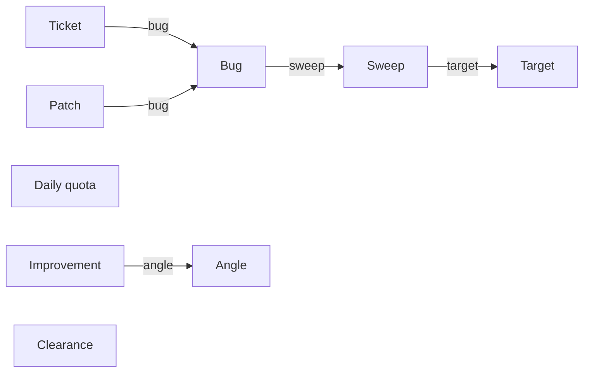

## Angle

> One concrete, citable reason to suspect an uninvestigated corner exists — proposed, chased down, and either built into something real or set aside with a reason. The practice's own backlog of what to try next, so a future sweep mines its own history instead of guessing.

Starts out proposed. Can be proposed, investigating, built, or discarded.

**How it fits**

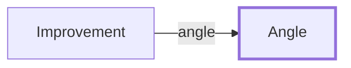

**How it moves**

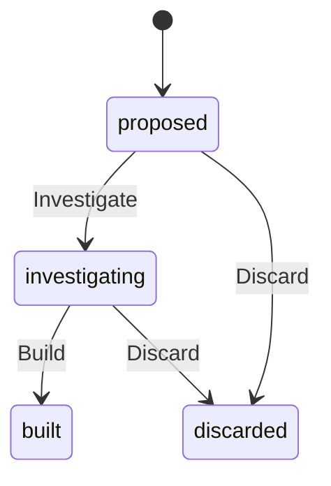

- Investigating an angle moves it from proposed to investigating.
- Building an angle moves it from investigating to built.
- Discarding an angle moves it from proposed or investigating to discarded.

**Always true**

- An angle is referenced.
- An angle says enough to be acted on without its proposer in the room, in at least 60 characters.
- An angle cites something concrete, not a mood.
- An angle is proposed by somebody.
- An instant is not before the epoch.
- A built angle says what actually got built.
- Discarding an angle says why.

### Actions

#### Build

Say what actually came of chasing this lead. Done by the qa engineer.

Needs a resolution ([Angle resolution](#angle-resolution)).

Sets the resolution and moves the angle from investigating to built.

Records [Angle built](#angle-built).

#### Discard

Decide a lead is not worth the practice's time, and say why. Done by the qa engineer.

Needs a reason ([Angle reason](#angle-reason)).

Sets the reason and moves the angle from proposed or investigating to discarded.

Records [Angle discarded](#angle-discarded).

#### Investigate

Pick a lead up for a real look, rather than leaving it to look picked-up by default. Done by the qa engineer.

Moves the angle from proposed to investigating.

Records [Angle investigated](#angle-investigated).

#### Propose

Write down a concrete, citable reason to suspect an uninvestigated corner exists, before it is lost to a conversation. Done by the qa engineer.

Needs a reference ([Angle reference](#angle-reference)), a premise ([Angle premise](#angle-premise)), a citation ([Angle citation](#angle-citation)), a proposer ([Proposer](#proposer)), and a now ([Instant](#instant)).

Sets the proposed at.

Records [Angle proposed](#angle-proposed).

### What it records

#### Angle built

Recorded after [Build](#build).

#### Angle discarded

Recorded after [Discard](#discard).

#### Angle investigated

Recorded after [Investigate](#investigate).

#### Angle proposed

Recorded after [Propose](#propose).

### Lists

#### All

Every angle ever proposed — what a runner mints the next reference from.

All angles, sorted by angle reference, A to Z.

#### Backlog

Leads nobody has finished chasing yet, oldest first — read this before inventing a new angle from scratch.

Angles that are proposed or investigating, sorted by instant, lowest first.

#### Citing

Every angle ever proposed on one exact citation, whatever became of it — the check before proposing another on the same fact.

Angles whose angle citation is the citation you give, sorted by angle reference, A to Z.

#### Resolved

Leads already acted on, one way or the other — built into something real, or discarded with a reason. Read beside Backlog for the practice's own hit rate.

Angles that are built or discarded, sorted by angle reference, A to Z.

#### Seed

Propose the practice's starting leads that are not on file yet; a lead already chased down is proposed, investigated and built in one pass.

All angles.

### What it is made of

#### Angle citation

Text that must not be blank.

Always true: an angle cites something concrete, not a mood.

#### Angle premise

Text that must not be blank.

Always true: an angle says enough to be acted on without its proposer in the room, in at least 60 characters.

#### Angle reason

Text that must not be blank.

Always true: discarding an angle says why.

#### Angle reference

Text that must not be blank.

Always true: an angle is referenced.

#### Angle resolution

Text that must not be blank.

Always true: a built angle says what actually got built.

#### Document

Made up of text (text).

#### Instant

A whole number.

Always true: an instant is not before the epoch.

#### Proposer

Text that must not be blank.

Always true: an angle is proposed by somebody.

## Bug

> One thing now known to be wrong, the test that proves it, and how far the fix got.

Starts out logged. Can be logged, investigating, fixed, verified, paused, or withdrawn.

**How it fits**

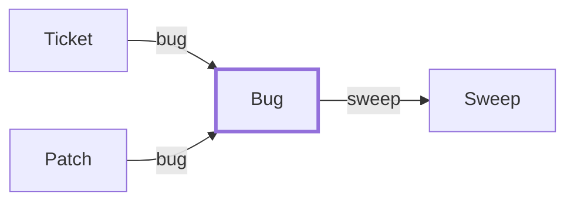

**How it moves**

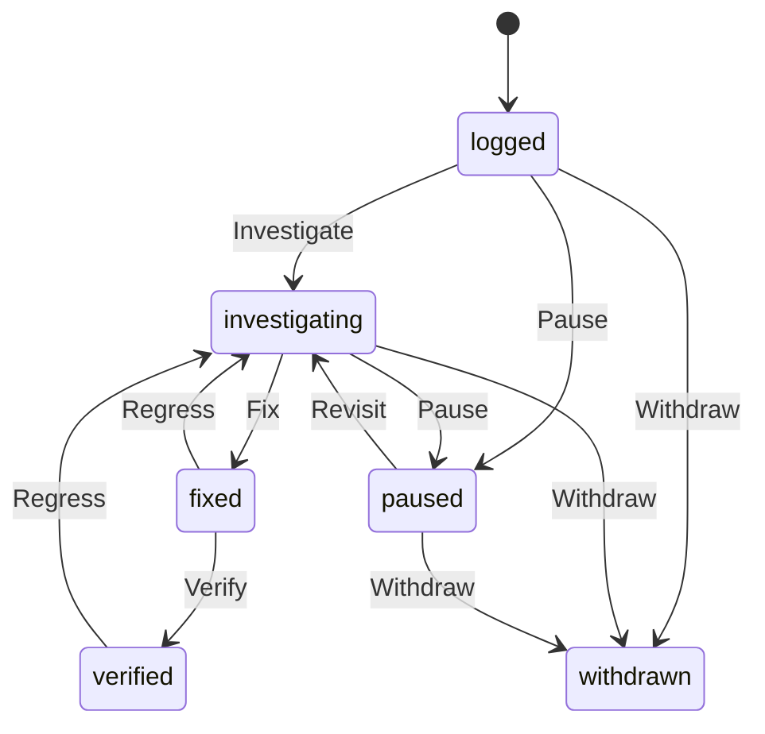

- Investigating a bug moves it from logged to investigating.
- Fixing a bug moves it from investigating to fixed.
- Verifying a bug moves it from fixed to verified.
- Pausing a bug moves it from logged or investigating to paused.
- Withdrawing from a bug moves it from logged, investigating, or paused to withdrawn.
- Regressing a bug moves it from fixed or verified to investigating.
- Revisiting a bug moves it from paused to investigating.

**Always true**

- Each bug belongs to one sweep.
- Each bug holds a list of tags.
- A bug is referenced.
- A bug sequence is positive.
- A bug is titled.
- A bug is proven by a test somebody can re-run.
- A bug says what actually happened.
- A bug says what should have happened.
- An investigation names where the bug lives.
- An investigation says why the code is wrong.
- A verification says what was actually run.
- Stopping on a bug says why.
- Stopping on a bug says what would move it.
- A waiver count is not negative.
- A waived gate says why.
- A gate is waived by a person, never by the loop.
- A waiver is signed.
- An instant is not before the epoch.
- A staleness window is positive.
- A bug is reported by somebody.
- An order is a position, not a direction.
- A tag is a word, not a sentence.

### Actions

#### Claim

Take the next bug off the queue, or one whose holder has gone quiet. Done by the qa engineer.

Needs a held by ([Engineer](#engineer)) and a now ([Instant](#instant-1)).

Allowed only when: a live claim is not taken from the agent holding it.

Sets the held by and the claimed at.

Records [Bug claimed](#bug-claimed).

#### Drop

Put a bug back on the queue without finishing it. Done by the qa engineer.

Needs a held by ([Engineer](#engineer)).

Sets the held by.

Records [Bug dropped](#bug-dropped).

#### Fix

Record the commit that makes it stop happening. Done by the qa engineer.

Needs a reference ([Bug reference](#bug-reference)) and a commit ([Commit ref](#commit-ref)).

Sets the commit and moves the bug from investigating to fixed.

Records [Bug fixed](#bug-fixed).

#### Investigate

Name the code that is wrong and say why. Done by the qa engineer.

Needs a site ([Bug site](#bug-site)) and a cause ([Bug cause](#bug-cause)).

Sets the site and the cause and moves the bug from logged to investigating.

Records [Bug investigated](#bug-investigated).

#### Log

Write down something that is wrong, with the test that proves it. Done by the qa engineer.

Needs a sweep ([Sweep](#sweep)), a reference ([Bug reference](#bug-reference)), a sequence ([Bug sequence](#bug-sequence)), a title ([Bug title](#bug-title)), a demonstration ([Demonstration](#demonstration)), a symptom ([Symptom](#symptom)), an expectation ([Expectation](#expectation)), a submitter ([Submitter](#submitter)), tags (a list of [Tag](#tag-1), optional), a name ([Bug name](#bug-name), optional), and a reproduced ([Reproduced](#reproduced), optional).

Records [Bug logged](#bug-logged).

#### Name

Give a bug a short, memorable slug — at log time or any point after. Done by the qa engineer.

Needs a name ([Bug name](#bug-name)).

Sets the name.

Records [Bug named](#bug-named).

#### Pause

Stop on a bug that is real and too large to fix here — why, and what would move it. Done by the qa engineer.

Needs a reason ([Bug reason](#bug-reason)) and a next step ([Next step](#next-step)).

Sets the reason and the next step and moves the bug from logged or investigating to paused.

Records [Bug paused](#bug-paused).

#### Rank

Say what should be dealt with first. Done by the qa engineer.

Needs an order ([Bug order](#bug-order)).

Sets the order.

Records [Bug ranked](#bug-ranked).

#### Regress

Put a bug back when its fix stopped holding. Done by the qa engineer.

Moves the bug from fixed or verified to investigating.

Records [Bug regressed](#bug-regressed).

#### Revisit

Pick a paused bug back up, investigation intact. Done by the qa engineer.

Moves the bug from paused to investigating.

Records [Bug revisited](#bug-revisited).

#### Tag

Say what kind of thing this bug is, so it can be found with its kind later. Done by the qa engineer.

Needs tags (a list of [Tag](#tag-1)).

Sets the tags.

Records [Bug tagged](#bug-tagged).

#### Triage

Write down whether this can be fixed on the spot or needs a bigger judgment. Done by the qa engineer.

Needs a disposition ([Disposition](#disposition)).

Allowed only when: a triage decides — self_contained or bigger, never undecided.

Sets the disposition.

Records [Bug triaged](#bug-triaged).

#### Verify

Record that the fix was actually verified, and exactly how. Done by the qa engineer.

Needs an evidence ([Verification](#verification)).

Sets the verification and moves the bug from fixed to verified.

Records [Bug verified](#bug-verified).

#### Waive

Go round a gate on this bug, on the record, signed by a person. Done by the qa engineer.

Needs a reason ([Waiver reason](#waiver-reason)) and a waived by ([Waived by](#waived-by)).

Raises the waived and sets the waived by.

Records [Gate waived](#gate-waived).

#### Withdraw

Take back a report whose test turned out to prove something else. Done by the qa engineer.

Needs a reason ([Bug reason](#bug-reason)).

Sets the reason and moves the bug from logged, investigating, or paused to withdrawn.

Records [Bug withdrawn](#bug-withdrawn).

### What it records

#### Bug claimed

Recorded after [Claim](#claim).

#### Bug dropped

Recorded after [Drop](#drop).

#### Bug fixed

Recorded after [Fix](#fix).

#### Bug investigated

Recorded after [Investigate](#investigate-1).

#### Bug logged

Recorded after [Log](#log).

#### Bug named

Recorded after [Name](#name).

#### Bug paused

Recorded after [Pause](#pause).

#### Bug ranked

Recorded after [Rank](#rank).

#### Bug regressed

Recorded after [Regress](#regress).

#### Bug revisited

Recorded after [Revisit](#revisit).

#### Bug tagged

Recorded after [Tag](#tag).

#### Bug triaged

Recorded after [Triage](#triage).

#### Bug verified

Recorded after [Verify](#verify).

#### Bug withdrawn

Recorded after [Withdraw](#withdraw).

### What happens on its own

#### Bug ci watch

Begins when [Bug fixed](#bug-fixed) happens and ends when [Clearance given](#clearance-given) happens. Along the way it can be watching or regressed.

### Lists

#### All

Every bug ever logged — what a runner mints the next reference from.

All bugs, sorted by bug sequence, lowest first.

#### Found in

Everything one sweep turned up, in the order it was found.

Bugs whose sweep is the sweep id you give, sorted by bug sequence, lowest first.

#### From

Every bug one submitter has ever logged, in whatever state — what an agent found, as against what it is holding.

Bugs whose submitter is the submitter you give, sorted by bug reference, A to Z.

#### In hand

Open bugs somebody is holding, and since when. A claim older than the window is free for the taking — read claimed_at before assuming somebody is on it.

Bugs that are logged or investigating and whose engineer is not nobody, sorted by instant, lowest first.

#### Needs judgment

Open bugs triaged bigger and not yet resolved — the pile still owed a human or agent judgment call, not one anybody can just fix off the queue.

Bugs whose disposition is bigger and that are logged, investigating, fixed, or paused, sorted by bug sequence, lowest first.

#### Open

Every bug still owed work — the open ledger, derived rather than maintained.

Bugs that are logged, investigating, or paused, sorted by bug sequence, lowest first.

#### Paused

Real, unfixed, stopped on, each with what would move it. The only queue a ticket is ever raised from.

Bugs that are paused, sorted by bug sequence, lowest first.

#### Queue

Open bugs nobody is holding, most important first, then oldest. The queue an agent takes from when it is fixing rather than sweeping.

Bugs that are logged or investigating and whose engineer is nobody, sorted by bug order, lowest first.

#### Ready to verify

Fixed and not yet re-run — the queue a full CI pass empties.

Bugs that are fixed, sorted by bug sequence, lowest first.

#### Tagged

Every bug carrying one tag, whatever state it is in — the way to find all the flaky ones, or everything about the projector.

Bugs whose tag includes the tag you give, sorted by bug reference, A to Z.

#### Untriaged

Live bugs (logged or investigating) nobody has triaged as self_contained or bigger yet — the judgment still owed on each.

Bugs that are logged or investigating and whose disposition is undecided, sorted by bug sequence, lowest first.

#### Waived

Bugs that went round one of their own gates — the honesty check on any claim about following the protocol.

Bugs whose waiver count is more than 0, sorted by bug sequence, lowest first.

#### Withdrawn

Reports whose test proved something other than what was claimed. Read the reasons: a run of these is a practice testing the wrong thing, not a runtime behaving.

Bugs that are withdrawn, sorted by bug sequence, lowest first.

### What it is made of

#### Bug cause

Text that must not be blank.

Always true: an investigation says why the code is wrong.

#### Bug name

Text that must follow a set format.

#### Bug order

A whole number.

Always true: an order is a position, not a direction.

#### Bug reason

Text that must not be blank.

Always true: stopping on a bug says why.

#### Bug reference

Text that must not be blank.

Always true: a bug is referenced.

#### Bug sequence

A whole number.

Always true: a bug sequence is positive.

#### Bug site

Text that must not be blank.

Always true: an investigation names where the bug lives.

#### Bug title

Text that must not be blank.

Always true: a bug is titled.

#### Commit ref

Text that must be a commit id.

#### Demonstration

Text that must not be blank.

Always true: a bug is proven by a test somebody can re-run.

#### Disposition

One of undecided, self_contained, or bigger.

#### Engineer

Text.

#### Expectation

Text that must not be blank.

Always true: a bug says what should have happened.

#### Instant

A whole number.

Always true: an instant is not before the epoch.

#### Next step

Text that must not be blank.

Always true: stopping on a bug says what would move it.

#### Reproduced

One of yes or no.

#### Stale after

A whole number.

Always true: a staleness window is positive.

#### Submitter

Text that must not be blank.

Always true: a bug is reported by somebody.

#### Sweep ref

Text.

#### Symptom

Text that must not be blank.

Always true: a bug says what actually happened.

#### Tag

Text that must follow a set format.

Always true: a tag is a word, not a sentence.

#### Verification

Text that must not be blank.

Always true: a verification says what was actually run.

#### Waived by

Text that must not be blank.

Always true: a gate is waived by a person, never by the loop; a waiver is signed.

#### Waiver count

A whole number.

Always true: a waiver count is not negative.

#### Waiver reason

Text that must not be blank.

Always true: a waived gate says why.

## Clearance

> One CI run against one commit, and therefore the only answer to whether that commit is safe to ship.

Starts out running. Can be running, green, or red.

**How it moves**

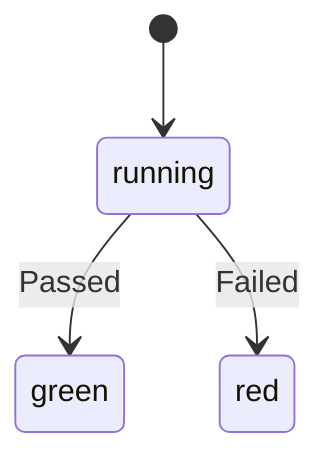

- Marking a clearance passed moves it from running to green.
- Marking a clearance failed moves it from running to red.

**Always true**

- A run says what it ran and what came back.

### Actions

#### Failed

Record that the suite went red against this commit. Done by the system.

Needs a refusal ([Run summary](#run-summary)).

Sets the summary and moves the clearance from running to red.

Records [Clearance refused](#clearance-refused).

#### Passed

Record that the suite went green against this commit. Done by the system.

Needs a summary ([Run summary](#run-summary)).

Sets the summary and moves the clearance from running to green.

Records [Clearance given](#clearance-given).

#### Start

Put a commit through CI. Done by the qa engineer.

Needs a commit ([Commit ref](#commit-ref-1)).

Records [Clearance started](#clearance-started).

### What it records

#### Clearance given

Recorded after [Passed](#passed).

#### Clearance refused

Recorded after [Failed](#failed).

#### Clearance started

Recorded after [Start](#start).

### Lists

#### All

Every CI run ever recorded, one per commit.

All clearances, sorted by commit ref, A to Z.

#### Check pull requests

Check CI for every PR the ledger tracks as open, a Patch or an Improvement: retire one GitHub reports merged or closed, and start a clearance for each unsettled head commit.

All clearances.

#### For

Is this exact commit cleared? Ask with the sha you are about to deploy; an empty answer is a no, including when nobody has run CI on it at all.

Clearances whose commit ref is the commit you give and that are green, sorted by commit ref, A to Z.

#### Red

Commits CI refused, with what it said.

Clearances that are red, sorted by commit ref, A to Z.

### What it is made of

#### Commit ref

Text that must be a commit id.

#### Document

Made up of text (text).

#### Run summary

Text that must not be blank.

Always true: a run says what it ran and what came back.

## Daily quota

> One UTC day's count of the pull requests the practice has opened, and the rule that the day's cap is not exceeded.

**Always true**

- A day is not before the epoch.
- A count of pull requests is not negative.
- A cap is not negative.

### Actions

#### Open

Open the day the clock reads, with no slot taken yet. Done by the qa engineer.

Needs a today ([Day](#day)).

Sets the today.

Records [Quota opened](#quota-opened).

#### Take

Take one of the day's slots for a pull request, refused once the day's cap is spent. Done by the qa engineer.

Needs a cap ([Slot cap](#slot-cap)).

Allowed only when: the day's cap is not spent.

Raises the used.

Records [Slot taken](#slot-taken).

### What it records

#### Quota opened

Recorded after [Open](#open-1).

#### Slot taken

Recorded after [Take](#take).

### Lists

#### Today

The quota of the day the clock reads: nothing before the day's first pull request.

Daily quotas whose day is the today you give.

### What it is made of

#### Day

A whole number.

Always true: a day is not before the epoch.

#### Slot cap

A whole number.

Always true: a cap is not negative.

#### Slots used

A whole number.

Always true: a count of pull requests is not negative.

## Improvement

> One pull request landed for deliberate, non-bugfix work — a domain-modeling addition, a tool, an aggregate this very practice needed — number, branch, and the exact commit that makes watching its CI a lookup instead of a guess, the same discipline `Patch` already keeps for a bug's own fix.

Starts out opened. Can be opened, landed, needs fix, merged, or closed.

**How it fits**

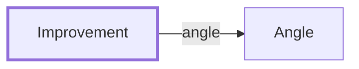

**How it moves**

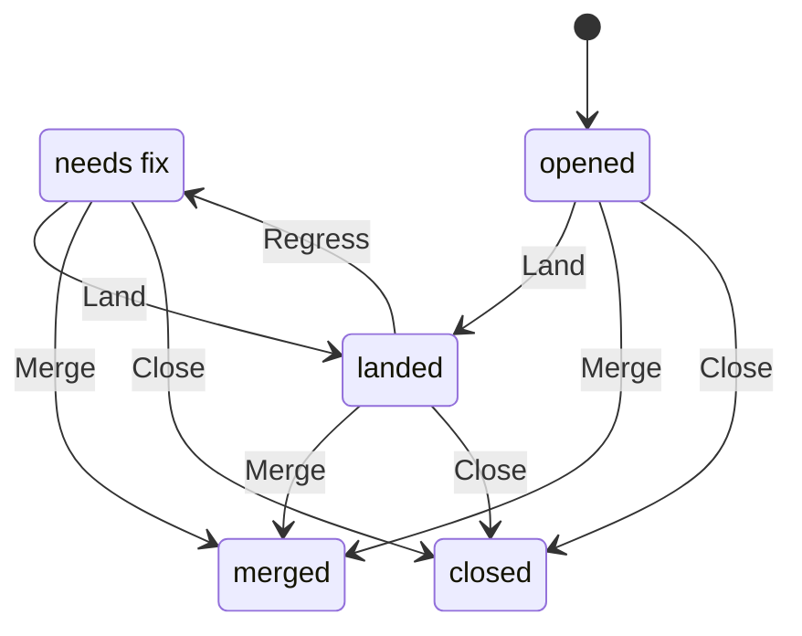

- Landing an improvement moves it from opened or needs fix to landed.
- Regressing an improvement moves it from landed to needs fix.
- Merging an improvement moves it from opened, landed, or needs fix to merged.
- Closing an improvement moves it from opened, landed, or needs fix to closed.

**Always true**

- Each improvement can belong to one angle.
- An instant is not before the epoch.
- An improvement is numbered.
- An improvement says where it lives.
- An improvement says which branch it is on.
- An improvement is titled.

### Actions

#### Close

Record that GitHub closed it without merging. Done by the qa engineer.

Moves the improvement from opened, landed, or needs fix to closed.

Records [Improvement closed](#improvement-closed).

#### Land

Record the commit this PR is now at, so CI can be watched for it — whether that is the commit it was opened with, or a fresh one pushed after a NeedsFix. Done by the qa engineer.

Needs a number ([Improvement number](#improvement-number)) and a commit ([Commit ref](#commit-ref-2)).

Sets the commit and moves the improvement from opened or needs fix to landed.

Records [Improvement landed](#improvement-landed).

#### Merge

Record that GitHub merged it. Done by the qa engineer.

Moves the improvement from opened, landed, or needs fix to merged.

Records [Improvement merged](#improvement-merged).

#### Open

Record that a deliberate, non-bugfix piece of work has been opened as a pull request, before its own commit is known to be worth watching. Done by the qa engineer.

Needs an angle ([Angle](#angle), optional), a number ([Improvement number](#improvement-number)), an url ([Improvement url](#improvement-url)), a branch ([Improvement branch](#improvement-branch)), a title ([Improvement title](#improvement-title)), and a now ([Instant](#instant-2)).

Allowed only when: the branch is one this practice recognises as its own; the angle is under investigation.

Sets the opened at.

Records [Improvement opened](#improvement-opened).

#### Regress

Put landed work back in front of somebody when its own commit stops holding. Done by the qa engineer.

Moves the improvement from landed to needs fix.

Records [Improvement regressed](#improvement-regressed).

### What it records

#### Improvement closed

Recorded after [Close](#close).

#### Improvement landed

Recorded after [Land](#land).

#### Improvement merged

Recorded after [Merge](#merge).

#### Improvement opened

Recorded after [Open](#open-2).

#### Improvement regressed

Recorded after [Regress](#regress-1).

### What happens on its own

#### Improvement ci watch

Begins when [Improvement landed](#improvement-landed) happens and ends when [Clearance given](#clearance-given) happens. Along the way it can be watching or regressed.

### Lists

#### All

Every improvement ever landed — what a runner reads back to reconcile against GitHub's own list.

All improvements, sorted by improvement number, lowest first.

#### For angle

Every improvement ever landed against one angle — the duplicate check, the same shape Patch.ForBug already gives for a bug.

Improvements whose angle is the angle id you give, sorted by improvement number, lowest first.

#### Needs fix

Landed work whose own commit came back red — what ImprovementCiWatch put back in front of somebody, and the list a human or agent clears with a fresh Land.

Improvements that are needs fix, sorted by improvement number, lowest first.

#### Open (the list)

Every PR we've landed for deliberate, non-bugfix work that's still open, by number — hecks quality_control clearance.check_pull_requests's own second worklist, the same shape Patch.Open already gives for a bug's own fix. For each of these, ask gh for exactly this number's CI status; nothing here is a guess.

Improvements that are opened, landed, or needs fix, sorted by improvement number, lowest first.

### What it is made of

#### Angle ref

Text.

#### Commit ref

Text that must be a commit id.

#### Improvement branch

Text that must not be blank.

Always true: an improvement says which branch it is on.

#### Improvement number

A whole number.

Always true: an improvement is numbered.

#### Improvement title

Text that must not be blank.

Always true: an improvement is titled.

#### Improvement url

Text that must not be blank.

Always true: an improvement says where it lives.

#### Instant

A whole number.

Always true: an instant is not before the epoch.

## Patch

> One pull request opened for a Bug's own fix — number, branch, and the exact commit that makes checking its CI status a lookup instead of a guess.

Starts out opened. Can be opened, merged, or closed.

**How it fits**

**How it moves**

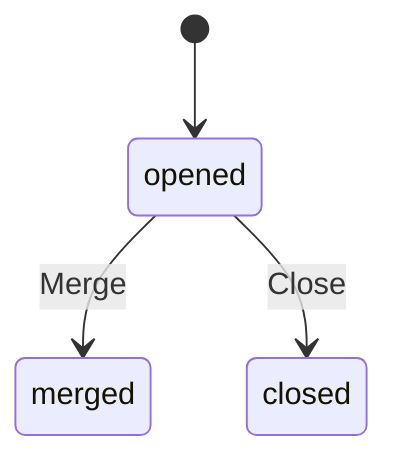

- Merging a patch moves it from opened to merged.
- Closing a patch moves it from opened to closed.

**Always true**

- Each patch belongs to one bug.
- An instant is not before the epoch.
- A patch is numbered.
- A patch says where it lives.
- A patch says which branch it is on.
- A patch is titled.

### Actions

#### Close

Record that GitHub closed it without merging. Done by the qa engineer.

Moves the patch from opened to closed.

Records [Patch closed](#patch-closed).

#### Merge

Record that GitHub merged it. Done by the qa engineer.

Moves the patch from opened to merged.

Records [Patch merged](#patch-merged).

#### Open

Record that a fix has been opened as a pull request, the moment its number, branch and commit are already known. Done by the qa engineer.

Needs a bug ([Bug](#bug)), a number ([Patch number](#patch-number)), an url ([Patch url](#patch-url)), a branch ([Patch branch](#patch-branch)), a commit ([Commit ref](#commit-ref-3)), a title ([Patch title](#patch-title)), and a now ([Instant](#instant-3)).

Allowed only when: the branch is one this practice recognises as its own; the bug is fixed.

Sets the opened at.

Records [Patch opened](#patch-opened).

### What it records

#### Patch closed

Recorded after [Close](#close-1).

#### Patch merged

Recorded after [Merge](#merge-1).

#### Patch opened

Recorded after [Open](#open-3).

### Lists

#### All

Every patch ever opened — what a runner reads back to reconcile against GitHub's own list.

All patches, sorted by patch number, lowest first.

#### For bug

Every patch ever opened for one bug — the duplicate check, the same shape Ticket.ForBug already gives for an issue.

Patches whose bug is the bug id you give, sorted by patch number, lowest first.

#### Open (the list)

Every PR we've opened that's still open, by number — hecks quality_control clearance.check_pull_requests's own worklist. For each of these, ask gh for exactly this number's CI status; nothing here is a guess.

Patches that are opened, sorted by patch number, lowest first.

### What it is made of

#### Bug ref

Text.

#### Commit ref

Text that must be a commit id.

#### Instant

A whole number.

Always true: an instant is not before the epoch.

#### Patch branch

Text that must not be blank.

Always true: a patch says which branch it is on.

#### Patch number

A whole number.

Always true: a patch is numbered.

#### Patch title

Text that must not be blank.

Always true: a patch is titled.

#### Patch url

Text that must not be blank.

Always true: a patch says where it lives.

## Sweep

> One agent's pass over one bluebook — every check it made, what each expected, and what actually came back.

Starts out sweeping. Can be sweeping, concluded, or abandoned.

**How it fits**

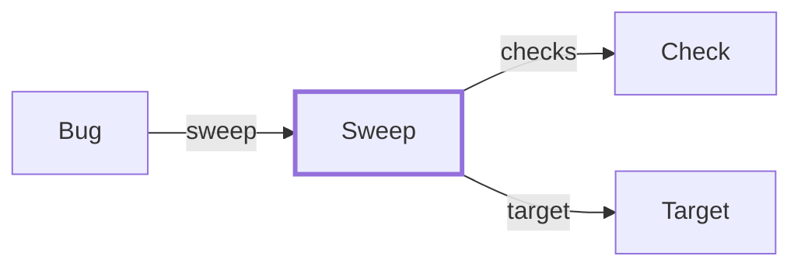

**How it moves**

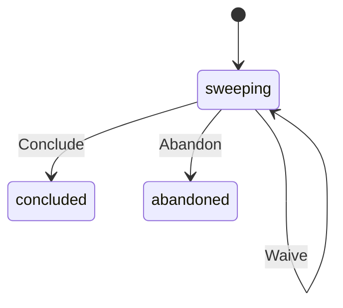

- Checking a sweep keeps it sweeping.
- Waiving a sweep keeps it sweeping.
- Concluding a sweep moves it from sweeping to concluded.
- Abandoning a sweep moves it from sweeping to abandoned.

**Always true**

- Each sweep belongs to one target.
- Each sweep holds a list of checks.
- A sweep is referenced.
- A sweep says who ran it.
- A check count is not negative.
- A waiver count is not negative.
- A sweep says what it learned, in at least 40 characters.
- A waived gate says why.
- A gate is waived by a person, never by the loop.
- A waiver is signed.
- A check sequence is positive.
- A check names what it put to the system.
- A check says what it expected.
- A domain is named by its path.
- A data directory is named by its path.
- A database is named.
- A role is named.
- A schema is named.
- A step names its verb.
- A step carries its arguments, `{}` for none.

### Actions

#### Abandon

End a pass whose output should not be trusted. Done by the qa engineer.

Moves the sweep from sweeping to abandoned.

Records [Sweep abandoned](#sweep-abandoned).

#### Check

Put one thing to the system, saying what it should do before looking. Done by the qa engineer.

Needs a subject ([Subject](#subject)) and an expectation ([Expectation](#expectation-1)).

Adds to the checks, raises the made, and keeps the sweep sweeping.

Afterwards, always: checking never loses a check.

Records [Check made](#check-made).

#### Conclude

End a pass and say what it taught. Done by the qa engineer.

Needs a notes ([Sweep notes](#sweep-notes)).

Allowed only when: a sweep that checked nothing tested nothing.

Sets the notes and moves the sweep from sweeping to concluded.

Records [Sweep concluded](#sweep-concluded).

#### Held

Record that the system did what the bluebook promised. Done by the qa engineer.

Needs a sequence ([Check sequence](#check-sequence)) and an observation ([Observation](#observation)).

Sets the observation and moves the check from made to held.

Records [Check held](#check-held).

#### Open

Begin a pass over one bluebook. Done by the qa engineer.

Needs a target ([Target](#target)), a reference ([Sweep reference](#sweep-reference)), and an engineer ([Engineer](#engineer-1)).

Records [Sweep opened](#sweep-opened).

#### Remake

Put a settled check back, against a system that has since changed. Done by the qa engineer.

Needs a sequence ([Check sequence](#check-sequence)).

Moves the check from held, surprising, or unsettled to made.

Records [Check remade](#check-remade).

#### Surprised

Record that the system did something other than what was written down. Done by the qa engineer.

Needs a sequence ([Check sequence](#check-sequence)), an observation ([Observation](#observation)), and a target ([Target ref](#target-ref)).

Sets the observation and the ever surprised and moves the check from made to surprising.

Records [Check surprised](#check-surprised).

#### Unsettled (check)

Record a check that ran and settled nothing. Done by the qa engineer.

Needs a sequence ([Check sequence](#check-sequence)) and an observation ([Observation](#observation)).

Sets the observation and moves the check from made to unsettled.

Records [Check unsettled](#check-unsettled).

#### Waive

Go round a gate, on the record, signed by a person. Done by the qa engineer.

Needs a reason ([Waiver reason](#waiver-reason-1)) and a waived by ([Waived by](#waived-by-1)).

Raises the waived, sets the waived by, and keeps the sweep sweeping.

Afterwards, always: a waiver is never silent.

Records [Gate waived](#gate-waived).

### What it records

#### Check held

Recorded after [Held](#held).

#### Check made

Recorded after [Check](#check).

#### Check remade

Recorded after [Remake](#remake).

#### Check surprised

Recorded after [Surprised](#surprised). Prompts [Suspend on surprise](#suspend-on-surprise).

#### Check unsettled

Recorded after [Unsettled (check)](#unsettled-check).

#### Gate waived

Recorded after [Waive (sweep)](#waive-1) or [Waive (bug)](#waive).

#### Sweep abandoned

Recorded after [Abandon](#abandon).

#### Sweep concluded

Recorded after [Conclude](#conclude).

#### Sweep opened

Recorded after [Open](#open-4).

### What happens on its own

#### Suspend on surprise

When [Check surprised](#check-surprised) happens, [Target](#target) is asked to [Suspend](#suspend).

### Lists

#### All

Every pass ever made — what a runner mints the next reference from.

All sweeps, sorted by sweep reference, A to Z.

#### Create ledger role

Create the ordinary Postgres role the ledger connects as and make it own the database; idempotent, and refuses a superuser or BYPASSRLS role, which the era write-fence cannot bind.

All sweeps.

#### For subject

Everything ever put to one verb, across every sweep. Count the rows and that is its coverage.

Checks whose subject is the subject you give, sorted by check sequence, lowest first.

#### Migrate ledger from heki

Copy each aggregate's current state from a Heki data directory into the repository the domain's bindings name today; a dry run unless `--force` is in the arguments, and an id held under a different state is always refused.

All sweeps.

#### Race

One racer of a concurrent dispatch: boot a domain against a schema and dispatch one step; the answer is `succeeded`, `refused` or `crashed:<class>: <message>`.

All sweeps.

#### Run

One claim, sweep, conclude and release cycle against a target (the rotation's pick when none is named), or every waiting target with `--all`; the first surprised check ends it with a report.

All sweeps.

#### Surprising

Every check the system surprised, across every sweep — the raw material a bug is written from, and the only list here that is supposed to be interesting.

Checks that are surprising, sorted by check sequence, lowest first.

#### Sweeping

Passes live right now — one per agent, and the reason a target shows as held.

Sweeps that are sweeping, sorted by sweep reference, A to Z.

#### Tick

One QA tick: a clean tree, a rebase on origin/main, the PR check, a sweep of the whole rotation and the generated domains, then one report. It never logs a bug, releases a hold or opens a PR.

All sweeps.

#### Unsettled (the list)

Made and never ruled on, plus the runs that settled nothing. A sweep concluded with rows here concluded early.

Checks that are made or unsettled, sorted by check sequence, lowest first.

#### Waived

Sweeps that went round a gate. Read as a fraction of all of them: a practice whose waiver rate is climbing is not moving faster, it is agreeing with itself less.

Sweeps whose waiver count is more than 0, sorted by sweep reference, A to Z.

### What it is made of

#### Check

One dispatch made against a written-down expectation, and what actually came back.

Starts out made. Can be made, held, surprising, or unsettled.

#### Check count

A whole number.

Always true: a check count is not negative.

#### Check sequence

A whole number.

Always true: a check sequence is positive.

#### Data path

Text that must not be empty.

Always true: a data directory is named by its path.

#### Database name

Text that must not be blank.

Always true: a database is named.

#### Document

Made up of text (text).

#### Domain path

Text that must not be empty.

Always true: a domain is named by its path.

#### Engineer

Text that must not be blank.

Always true: a sweep says who ran it.

#### Ever surprised

One of no or yes.

#### Expectation

Text that must not be blank.

Always true: a check says what it expected.

#### Listing

Text.

#### Observation

Text.

#### Role name

Text that must not be blank.

Always true: a role is named.

#### Schema name

Text that must not be blank.

Always true: a schema is named.

#### Step arguments

Text.

Always true: a step carries its arguments, `{}` for none.

#### Step verb

Text that must not be blank.

Always true: a step names its verb.

#### Subject

Text that must not be blank.

Always true: a check names what it put to the system.

#### Sweep notes

Text that must not be blank.

Always true: a sweep says what it learned, in at least 40 characters.

#### Sweep reference

Text that must not be blank.

Always true: a sweep is referenced.

#### Target ref

Text.

#### Waived by

Text that must not be blank.

Always true: a gate is waived by a person, never by the loop; a waiver is signed.

#### Waiver count

A whole number.

Always true: a waiver count is not negative.

#### Waiver reason

Text that must not be blank.

Always true: a waived gate says why.

#### Words

Text that must be one line.

## Target

> A bluebook that can be pressure-tested, and whose turn it is — the rotation, and the claim that stops two agents doing the same work twice.

Starts out waiting. Can be waiting, held, suspended, or shelved.

**How it fits**

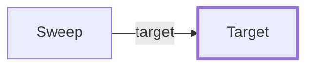

**How it moves**

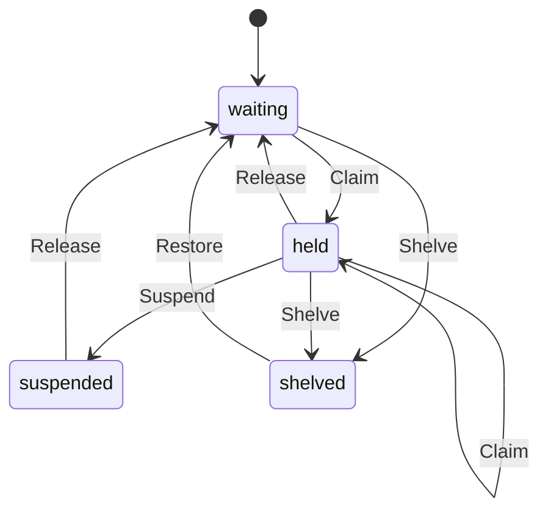

- Claiming a target moves it from waiting or held to held.
- Releasing a target moves it from held or suspended to waiting.
- Suspending a target moves it from held to suspended.
- Shelving a target moves it from waiting or held to shelved.
- Restoring a target moves it from shelved to waiting.

**Always true**

- A target is referenced.
- A target says where it is.
- An instant is not before the epoch.
- A sweep time is not before the epoch.
- A streak is not negative.
- Shelving a target says why.
- A mode is named.
- A yield score is not negative.
- A staleness window is positive.
- A domain is named by its path.

### Actions

#### Claim

Take the next bluebook in the rotation, or one whose holder has gone quiet. Done by the qa engineer.

Needs a held by ([Engineer](#engineer-2)) and a now ([Instant](#instant-4)).

Allowed only when: a live claim is not taken from the agent holding it.

Sets the held by and the claimed at and moves the target from waiting or held to held.

Records [Target claimed](#target-claimed).

#### Identify

Write down that a bluebook exists which nobody has swept. Done by the qa engineer.

Needs a reference ([Target reference](#target-reference)) and a path ([Target path](#target-path)).

Records [Target identified](#target-identified).

#### Release

Hand a bluebook back to the rotation, stamped with when, what this pass was worth, and how the clean streak moves. Done by the qa engineer.

Needs a now ([Instant](#instant-4)), a next streak ([Clean streak](#clean-streak)), a capabilities ([Capabilities](#capabilities)), and a yield score ([Yield score](#yield-score)).

Sets the last swept, the yield score, the clean streak, and the capabilities and moves the target from held or suspended to waiting.

Records [Target released](#target-released).

#### Relocate

Correct where a bluebook's own domain actually lives, once its recorded path stops resolving. Done by the qa engineer.

Needs a path ([Target path](#target-path)).

Sets the path.

Records [Target relocated](#target-relocated).

#### Restore

Put a shelved bluebook back in the rotation, and say what changed. Done by the qa engineer.

Needs a reason ([Target reason](#target-reason)).

Sets the reason and moves the target from shelved to waiting.

Records [Target restored](#target-restored).

#### Shelve

Decide a bluebook is not worth the practice's time, and say why. Done by the qa engineer.

Needs a reason ([Target reason](#target-reason)).

Sets the reason and moves the target from waiting or held to shelved.

Records [Target shelved](#target-shelved).

#### Suspend

Take a bluebook out of the rotation because a check surprised, until a person releases it. Done by the system.

Needs a reason ([Target reason](#target-reason)).

Sets the reason and moves the target from held to suspended.

Records [Target suspended](#target-suspended).

### What it records

#### Target claimed

Recorded after [Claim](#claim-1).

#### Target identified

Recorded after [Identify](#identify).

#### Target released

Recorded after [Release](#release).

#### Target relocated

Recorded after [Relocate](#relocate).

#### Target restored

Recorded after [Restore](#restore).

#### Target shelved

Recorded after [Shelve](#shelve).

#### Target suspended

Recorded after [Suspend](#suspend).

### Lists

#### All

Every bluebook ever written down — the inventory a runner walking the repository checks its findings against.

All targets, sorted by target reference, A to Z.

#### Check generated domains

Generate domains nobody wrote and check them the way the rotation does: a domain that does not boot is invalid, never a finding.

All targets.

#### Discover external domains

Sibling-repo domains that already depend on the hecks gem but are not enrolled yet; it reports and never enrols.

All targets.

#### Eligible for

Waiting bluebooks whose recorded capabilities include one mode — e.g. mode=postgres_era for the persistence-parity axis. The ledger's own answer to which bluebooks a mode can reach; inference at sweep time is still what decides.

Targets whose capabilities includes the mode you give and that are waiting, sorted by swept in, lowest first.

#### Held

Claimed right now, and by whom. Read it before wondering why the rotation looks short — a claim older than the window is free for the taking.

Targets that are held, sorted by instant, lowest first.

#### Judge novelty

Whether a new stress domain puts two forms together on one aggregate that no existing target does: the gate before it becomes a target.

All targets.

#### Mine combinations

Ask an agent to mine the adversarial corpus for new domain combinations, then check the ones that boot; opt-in, since an agent call costs money.

All targets.

#### Mutate

Mutation-test the Rust kernel: change one operator or return value at a time and run its tests; a mutant no test catches is a finding.

All targets.

#### Rotation

Whose turn it is — waiting bluebooks, least recently swept first. The one reason this aggregate exists. Raw ordering only — see Hecks::Fuzzing::RotationPriority for the yield-weighted pick built on top of these same rows.

Targets that are waiting, sorted by swept in, lowest first.

#### Seed

Identify every corpus domain as a rotation target, printing each one's inferred capabilities; one already on file is skipped.

All targets.

#### Shelved

Deliberately not swept, each with its reason. Re-read before anybody claims a coverage number.

Targets that are shelved, sorted by target reference, A to Z.

#### Suspended

Bluebooks a check surprised, waiting for a person — each with the reason the policy wrote. Nothing automatic touches these; hecks quality_control query sweep.run <target> --release --notes is how one comes back.

Targets that are suspended, sorted by target reference, A to Z.

#### Untouched

Never swept at all — zero is the epoch and means nobody has looked. The gap no count of checks can show you, because an unswept bluebook leaves no rows anywhere.

Targets that are waiting and whose swept in is 0, sorted by target reference, A to Z.

### What it is made of

#### Capabilities

Text.

#### Capability

Text that must not be blank.

Always true: a mode is named.

#### Clean streak

A whole number.

Always true: a streak is not negative.

#### Document

Made up of text (text).

#### Domain path

Text that must not be empty.

Always true: a domain is named by its path.

#### Engineer

Text.

#### Instant

A whole number.

Always true: an instant is not before the epoch.

#### Stale after

A whole number.

Always true: a staleness window is positive.

#### Swept in

A whole number.

Always true: a sweep time is not before the epoch.

#### Target path

Text that must not be blank.

Always true: a target says where it is.

#### Target reason

Text that must not be blank.

Always true: shelving a target says why.

#### Target reference

Text that must not be blank.

Always true: a target is referenced.

#### Words

Text that must be one line.

#### Yield score

A whole number.

Always true: a yield score is not negative.

## Ticket

> One issue raised in a tracker outside this repository — what it says, whether the tracker took it, and how many times we have asked.

Starts out raised. Can be raised, submitting, filed, refused, abandoned, or closed.

**How it fits**

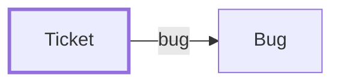

**How it moves**

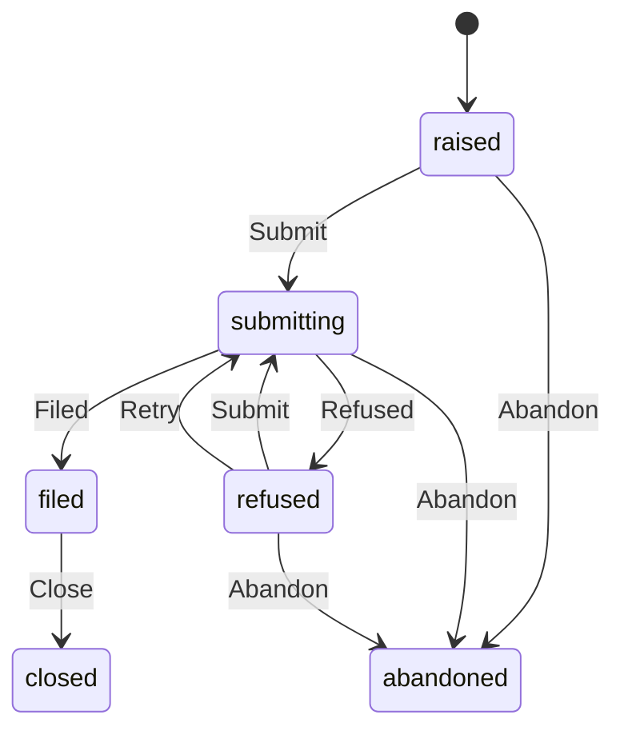

- Submitting a ticket moves it from raised or refused to submitting.
- Marking a ticket filed moves it from submitting to filed.
- Marking a ticket refused moves it from submitting to refused.
- Retrying a ticket moves it from refused to submitting.
- Abandoning a ticket moves it from raised, submitting, or refused to abandoned.
- Closing a ticket moves it from filed to closed.

**Always true**

- Each ticket belongs to one bug.
- A ticket is referenced.
- A ticket is titled.
- A ticket says something.
- An issue number is not negative.
- An attempt count is not negative.
- A filing is attempted at least once.

### Actions

#### Abandon

Stop asking, and put it in front of a person. Done by the qa engineer.

Moves the ticket from raised, submitting, or refused to abandoned.

Records [Ticket filing abandoned](#ticket-filing-abandoned).

#### Close

Record that the issue is done with. Done by the qa engineer.

Moves the ticket from filed to closed.

Records [Ticket closed](#ticket-closed).

#### Filed

Record that the tracker took it, and where it landed. Done by the system.

Needs a number ([Issue number](#issue-number)) and an url ([Issue url](#issue-url)).

Sets the number and the url and moves the ticket from submitting to filed.

Records [Ticket filed](#ticket-filed).

#### Raise

Say the outside world needs to know about a bug we could not fix. Done by the qa engineer.

Needs a bug ([Bug](#bug)), a reference ([Ticket reference](#ticket-reference)), a repository ([Ticket repository](#ticket-repository)), a title ([Ticket title](#ticket-title)), a body ([Ticket body](#ticket-body)), and a pull request ([Pull request](#pull-request), optional).

Records [Ticket raised](#ticket-raised).

#### Refused

Record that the tracker would not take it, and what it said. Done by the system.

Needs a refusal ([Refusal text](#refusal-text)).

Sets the refusal, raises the attempts, and moves the ticket from submitting to refused.

Records [Ticket filing refused](#ticket-filing-refused).

#### Retry

Ask again, up to the limit, carrying what was refused. Done by the system.

Needs a refusal ([Refusal text](#refusal-text)).

Allowed only when: a retry is still allowed.

Sets the refusal and moves the ticket from refused to submitting.

Records [Ticket retried](#ticket-retried).

#### Submit

Send it — the last reversible moment. Done by the qa engineer.

Moves the ticket from raised or refused to submitting.

Records [Ticket submitted](#ticket-submitted).

### What it records

#### Ticket closed

Recorded after [Close](#close-2).

#### Ticket filed

Recorded after [Filed](#filed).

#### Ticket filing abandoned

Recorded after [Abandon](#abandon-1).

#### Ticket filing refused

Recorded after [Refused](#refused). Prompts [Ask again](#ask-again).

#### Ticket raised

Recorded after [Raise](#raise).

#### Ticket retried

Recorded after [Retry](#retry). Prompts [Ask once more](#ask-once-more).

#### Ticket submitted

Recorded after [Submit](#submit). Prompts [File when submitted](#file-when-submitted).

### What happens on its own

#### Ask again

When [Ticket filing refused](#ticket-filing-refused) happens, [Ticket](#ticket) is asked to [Retry](#retry).

#### Ask once more

When [Ticket retried](#ticket-retried) happens, Ticket::issue tracker is asked to File.

#### File when submitted

When [Ticket submitted](#ticket-submitted) happens, Ticket::issue tracker is asked to File.

### Lists

#### Abandoned

Asked three times, refused three times. Every row belongs in the report, because nothing automatic will touch it again.

Tickets that are abandoned, sorted by ticket reference, A to Z.

#### All

Every ticket ever raised.

All tickets, sorted by ticket reference, A to Z.

#### Filed (the list)

Open issues this practice is responsible for, out in the world.

Tickets that are filed, sorted by issue number, lowest first.

#### For bug

Every ticket ever raised about one bug — the duplicate check, before a second is raised.

Tickets whose bug is the bug id you give, sorted by ticket reference, A to Z.

#### Proposed

Tickets that already carry a pull request — a fix exists, so more work filed against them is duplicated effort.

Tickets whose pull request is not , sorted by ticket reference, A to Z.

#### Raised

Composed and not sent. Nothing will happen to these until somebody submits one.

Tickets that are raised, sorted by ticket reference, A to Z.

#### Refused (the list)

The tracker said no, and what it said. Retried automatically until the cap.

Tickets that are refused, sorted by ticket reference, A to Z.

#### Resting on fixed

Tickets about a bug this repository went on to fix itself. Each one owes the outside world a Close.

Tickets that are filed and whose bug's status is fixed or verified, sorted by issue number, lowest first.

#### Resting on unpaused

Tickets about a bug nobody has stopped on. Raise an issue only for something you could not fix yourself — this is the list where that gets skipped.

Tickets that are raised or filed and whose bug's status is logged or investigating, sorted by ticket reference, A to Z.

#### Submitting

Sent and not yet answered. A row that sticks here is a call whose outcome nobody recorded — look at the tracker before asking again, or a retry files a duplicate.

Tickets that are submitting, sorted by ticket reference, A to Z.

### What it is made of

#### Attempt count

A whole number.

Always true: an attempt count is not negative.

#### Bug ref

Text.

#### Issue number

A whole number.

Always true: an issue number is not negative.

#### Issue url

Text.

#### Max attempts

A whole number.

Always true: a filing is attempted at least once.

#### Pull request

Text.

#### Refusal text

Text.

#### Ticket body

Text that must not be blank.

Always true: a ticket says something.

#### Ticket reference

Text that must not be blank.

Always true: a ticket is referenced.

#### Ticket repository

Text that must follow a set format.

#### Ticket title

Text that must not be blank.

Always true: a ticket is titled.

## Roles

> Who does what. Each role is listed once, with the actions it is responsible for.

#### QA engineer

Responsible for [Identify](#identify), [Claim (target)](#claim-1), [Release](#release), [Shelve](#shelve), [Restore](#restore), [Relocate](#relocate), [Open (sweep)](#open-4), [Check](#check), [Waive (sweep)](#waive-1), [Conclude](#conclude), [Abandon (sweep)](#abandon), [Held](#held), [Surprised](#surprised), [Unsettled (check)](#unsettled-check), [Remake](#remake), [Log](#log), [Rank](#rank), [Tag](#tag), [Triage](#triage), [Name](#name), [Claim (bug)](#claim), [Drop](#drop), [Investigate (bug)](#investigate-1), [Fix](#fix), [Verify](#verify), [Pause](#pause), [Withdraw](#withdraw), [Regress (bug)](#regress), [Revisit](#revisit), [Waive (bug)](#waive), [Propose](#propose), [Investigate (angle)](#investigate), [Build](#build), [Discard](#discard), [Raise](#raise), [Submit](#submit), [Abandon (ticket)](#abandon-1), [Close (ticket)](#close-2), [Open (patch)](#open-3), [Merge (patch)](#merge-1), [Close (patch)](#close-1), [Open (daily quota)](#open-1), [Take](#take), [Open (improvement)](#open-2), [Land](#land), [Regress (improvement)](#regress-1), [Merge (improvement)](#merge), [Close (improvement)](#close), and [Start](#start).

#### System

Responsible for [Suspend](#suspend), [Filed](#filed), [Refused](#refused), [Retry](#retry), [Passed](#passed), and [Failed](#failed).

## Read models

> Questions answered by reading more than one of the things above.

#### Bugs by disposition

Every bug sorted by the call its finder made — self-contained, bigger, or not yet decided — beside its reference. The fix-rate, and the judgment still owed, at a glance.

#### Bugs by status

Every bug sorted into what became of it — the tally. The share that is withdrawn, beside the share verified, is the honesty check on the whole practice.

#### Bugs by submitter

Every bug sorted by who reported it, then by its own reference — what each agent has actually found.

#### Improvements by status

Every improvement sorted into what became of it — landed, needing a fix, merged, or closed, at a glance.

#### Tickets by status

Every ticket sorted by where it got to — stuck filings and abandoned ones are only visible as a count.

## Reactions

> What happens on its own when something arrives from outside this specification.

#### Clear on pass

When "Suite passed" arrives from outside, [Clearance](#clearance) is asked to [Passed](#passed).

#### Close when closed upstream

When "Issue closed upstream" arrives from outside, [Ticket](#ticket) is asked to [Close](#close-2).

#### Record the issue

When "Issue filed" arrives from outside, [Ticket](#ticket) is asked to [Filed](#filed).

#### Record the refusal

When "Issue filing refused" arrives from outside, [Ticket](#ticket) is asked to [Refused](#refused).

#### Refuse on fail

When "Suite failed" arrives from outside, [Clearance](#clearance) is asked to [Failed](#failed).
